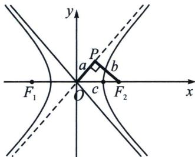
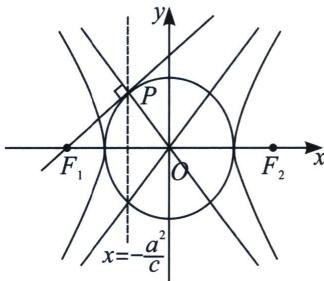

# 双曲线焦点到渐近线的距离

## 2026版高中《mst老唐说题》圆锥曲线专题（数学）

## 一、焦点到渐近线距离构造特征三角形

双曲线 $\frac{x^{2}}{a^{2}}-\frac{y^{2}}{b^{2}}=1(a>0,\ b>0)$ 的焦点到渐近线的距离为定值b，如左图所示，由于渐近线OP的斜率为

$\frac{b}{a}$ ，又 $|OF_2| = c$ ， $a^2 + b^2 = c^2$ ，显然 $PF_{2}$ 的长度是定值 $b$

如右图所示, 过双曲线 $\frac{x^{2}}{a^{2}} - \frac{y^{2}}{b^{2}} = 1 (a > 0, b > 0)$ 的左焦点 $F_{1}(-c, 0)(c > 0)$ 作圆 $x^{2} + y^{2} = a^{2}$ 的切线, 切点为 $P$ , 那么, 点 $P$ 在渐近线 $y = -\frac{b}{a} x$ 上, 也在左准线 $x = -\frac{a^{2}}{c}$ 上, 即点 $P\left(-\frac{a^{2}}{c}, \frac{ab}{c}\right)$ .

## 1. 利用对称性构造直角三角形

## 相关原子

- [双曲线的定义与标准方程](%E5%8F%8C%E6%9B%B2%E7%BA%BF%E7%9A%84%E5%AE%9A%E4%B9%89%E4%B8%8E%E6%A0%87%E5%87%86%E6%96%B9%E7%A8%8B.md)
- [双曲线的渐近线](%E5%8F%8C%E6%9B%B2%E7%BA%BF%E7%9A%84%E6%B8%90%E8%BF%91%E7%BA%BF.md)

## 所属组织

- [一、焦点到渐近线距离构造特征三角形](../%E7%9F%A5%E8%AF%86%E4%B8%B2%E8%81%94/mst%E8%80%81%E5%94%90%E8%AF%B4%E9%A2%98-%E5%9C%86%E9%94%A5%E6%9B%B2%E7%BA%BF-2026/%E4%B8%8A%E5%86%8C/%E7%AC%AC02%E7%AB%A0_%E7%A6%BB%E5%BF%83%E7%8E%87/%E7%AC%AC%E4%BA%8C%E8%8A%82_%E5%87%A0%E4%BD%95%E6%80%A7%E8%B4%A8%E4%B8%8B%E7%9A%84%E6%B8%90%E8%BF%91%E7%BA%BF%E6%A8%A1%E5%9E%8B/%E4%B8%80_%E7%84%A6%E7%82%B9%E5%88%B0%E6%B8%90%E8%BF%91%E7%BA%BF%E8%B7%9D%E7%A6%BB%E6%9E%84%E9%80%A0%E7%89%B9%E5%BE%81%E4%B8%89%E8%A7%92%E5%BD%A2/%E4%B8%80_%E7%84%A6%E7%82%B9%E5%88%B0%E6%B8%90%E8%BF%91%E7%BA%BF%E8%B7%9D%E7%A6%BB%E6%9E%84%E9%80%A0%E7%89%B9%E5%BE%81%E4%B8%89%E8%A7%92%E5%BD%A2.md)

## 题型训练 · 2026版高中《mst老唐说题》圆锥曲线专题（数学）

### 离心率 / 第二节 几何性质下的渐近线模型

> [!example]- 一、焦点到渐近线距离构造特征三角形
> 

> [!example]- 五、渐近线焦长公式推导方案
> 
