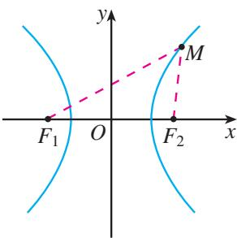
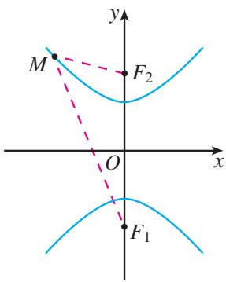

在直线 $l$ 上取两个定点 $A, B$ ，设 $P$ 是直线 $l$ 上位于线段 $AB$ 外的动点；在平面内取两个定点 $F_{1}, F_{2}$ ，分别以 $F_{1}$ 为圆心、$|PA|$ 为半径，以 $F_{2}$ 为圆心、$|PB|$ 为半径作圆，设两圆的交点为 $M$ 。在 $|AB| < |F_1F_2| \leqslant |PA| + |PB|$ 的条件下，当点 $M$ 靠近定点 $F_1$ 时， $|MF_2| - |MF_1| = |AB|$ ；当点 $M$ 靠近定点 $F_2$ 时， $|MF_1| - |MF_2| = |AB|$ 。总之，点 $M$ 与两个定点 $F_1$ ， $F_2$ 距离的差的绝对值 $|AB|$ 是一个常数 $(|AB| < |F_1F_2|)$ 。这时，两圆交点的轨迹是不同于椭圆的曲线，它分左右两支。

一般地，我们把平面内与两个定点 $F_{1}$ ， $F_{2}$ 的距离的差的绝对值等于非零常数（小于 $\left|F_{1}F_{2}\right|$ ）的点的轨迹叫做双曲线（hyperbola）。这两个定点叫做双曲线的焦点，两焦点间的距离叫做双曲线的焦距。

类比求椭圆标准方程的过程，可以通过建立适当的坐标系来得出双曲线的标准方程。双曲线具有对称性，而且直线 $F_{1}F_{2}$ 是它的一条对称轴，所以我们取经过两焦点 $F_{1}$ 和 $F_{2}$ 的直线为 $x$ 轴，线段 $F_{1}F_{2}$ 的垂直平分线为 $y$ 轴，建立如图3.2-3所示的平面直角坐标系 $Oxy$ 。设 $M(x,y)$ 是双曲线上任意一点，双曲线的焦距为 $2c(c>0)$ ，那么，焦点 $F_{1}$ ， $F_{2}$ 的坐标分别是 $(-c,0)$ ， $(c,0)$ ，又设 $||MF_{1}|-|MF_{2}||=2a$ （ $a$ 为大于 $0$ 的常数， $a<c$ ）。

  
图3.2-3

由双曲线的定义，双曲线就是下列点的集合：

$$
P = \{M \mid \left| | M F _ {1} | - | M F _ {2} | \right| = 2 a, 0 <   2 a <   | F _ {1} F _ {2} | \}.
$$

因为

$$
\begin{array}{l} \left| M F _ {1} \right| = \sqrt {(x + c) ^ {2} + y ^ {2}}, \\ \left| M F _ {2} \right| = \sqrt {(x - c) ^ {2} + y ^ {2}}, \end{array}
$$

所以

$$
\sqrt {(x + c) ^ {2} + y ^ {2}} - \sqrt {(x - c) ^ {2} + y ^ {2}} = \pm 2 a.\tag{①}
$$

类比椭圆标准方程的化简过程，化简①，得

$$
\left(c ^ {2} - a ^ {2}\right) x ^ {2} - a ^ {2} y ^ {2} = a ^ {2} \left(c ^ {2} - a ^ {2}\right),
$$

两边同除以 $a^2 (c^2 - a^2)$ ，得

$$
\frac {x ^ {2}}{a ^ {2}} - \frac {y ^ {2}}{c ^ {2} - a ^ {2}} = 1.
$$

由双曲线的定义知，2c>2a，即 c>a，所以 $c^{2}-a^{2}>0$ .

类比椭圆标准方程的建立过程，令 $b^{2}=c^{2}-a^{2}$ ，其中 b>0，代入上式，得

$$
\frac {x ^ {2}}{a ^ {2}} - \frac {y ^ {2}}{b ^ {2}} = 1 (a > 0, b > 0).\tag{②}
$$

从上述过程可以看到，双曲线上任意一点的坐标 $(x, y)$ 都是方程②的解；以方程②的解为坐标的点 $(x, y)$ 与双曲线的两个焦点 $F_{1}(-c, 0)$ ， $F_{2}(c, 0)$ 的距离之差的绝对值都为 $2a$ ，即以方程②的解为坐标的点都在双曲线上。我们称方程②是双曲线的方程，这个方程叫做双曲线的标准方程。它表示焦点在 $x$ 轴上，焦点分别是 $F_{1}(-c, 0)$ ， $F_{2}(c, 0)$ 的双曲线，这里 $c^{2}=a^{2}+b^{2}$ 。

类比焦点在 $y$ 轴上的椭圆标准方程，如图 3.2-4，如果双曲线的焦点在 $y$ 轴上，焦距为 $2c$ ，焦点分别是 $F_{1}(0, -c)$ ， $F_{2}(0, c)$ ， $a, b$ 的意义同上，这时双曲线的方程是

$$
\frac {y ^ {2}}{a ^ {2}} - \frac {x ^ {2}}{b ^ {2}} = 1 (a > 0, b > 0),
$$

这个方程也是双曲线的标准方程.

