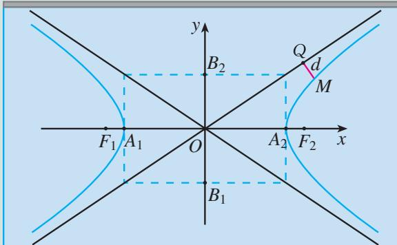

对于双曲线 $\frac{x^2}{9} - \frac{y^2}{4} = 1$ 和两条直线 $\frac{x}{3} \pm \frac{y}{2} = 0$ （图3.2-9），当点 $M$ 沿双曲线的右支向右上方运动时，点 $M$ 的横坐标 $x_{M}$ 越来越大，点 $M$ 到直线 $\frac{x}{3} - \frac{y}{2} = 0$ 的距离 $d$ 越来越小，但是 $d$ 始终不等于 $0$ 。

  
图3.2-9

实际上，经过双曲线的顶点 $A_{1}(-3, 0)$ ， $A_{2}(3, 0)$ 作 $y$ 轴的平行线 $x = \pm 3$ ，经过虚轴端点 $B_{1}(0, -2)$ ， $B_{2}(0, 2)$ 作 $x$ 轴的平行线 $y = \pm 2$ ，四条直线围成一个矩形（图3.2-9），矩形的两条对角线所在直线的方程是 $\frac{x}{3} \pm \frac{y}{2} = 0$ 。可以发现，双曲线 $\frac{x^2}{9} - \frac{y^2}{4} = 1$ 的两支向外延伸时，与两条直线 $\frac{x}{3} \pm \frac{y}{2} = 0$ 逐渐接近，但永远不相交。

一般地，双曲线 $\frac{x^2}{a^2} -\frac{y^2}{b^2} = 1$ （ $a > 0$ ， $b > 0$ ）的两支向外延伸时，与两条直线 $\frac{x}{a}\pm \frac{y}{b} = 0$ 逐渐接近，我们把这两条直线叫做双曲线的渐近线．实际上，双曲线与它的渐近线无限接近，但永远不相交.

在双曲线方程 $\frac{x^{2}}{a^{2}}-\frac{y^{2}}{b^{2}}=1\quad(a>0,\quad b>0)$ 中，如果a=b，那么方程变为 $x^{2}-y^{2}=a^{2}$ ，此时双曲线的实轴和虚轴的长都等于2a。这时，四条直线 $x=\pm a,\quad y=\pm a$ 围成正方形，渐近线方程为 $y=\pm x$ ，它们互相垂直，并且平分双曲线的实轴和虚轴所成的角。实轴和虚轴等长的双曲线叫做等轴双曲线。
