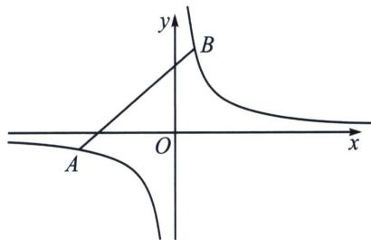

# 反比例函数两点对合与数列构造

## 2026版高中《mst老唐说题》圆锥曲线专题（数学）

## 第一节 反比例对合方程解决圆锥曲线与数列综合

2024 年新高考Ⅱ卷 19 题，就是考查了神奇的反比例对合方程！

如图， $A(x_{1}, y_{1})$ 和 $B(x_{2}, y_{2})$ 分别是反比例函数（等轴双曲线） $y=\frac{m}{x}$ 上的两点，则 AB 的两点对合式方程为： $\frac{x_{1}x_{2}}{m}y+x=x_{1}+x_{2}$ .

证明：由于 $k_{AB} = \frac{\frac{m}{x_1} - \frac{m}{x_2}}{x_1 - x_2} = -\frac{m}{x_1x_2}$ ，故 $AB: y - \frac{m}{x_1} = -\frac{m}{x_1x_2}(x - x_1)$ ，即 $\frac{x_1x_2}{m} y + x = x_1 + x_2$

和抛物线的两点对合式一样，在这个两步就能证明的式子背后，隐藏了很多我们平时没抓住的信息，比如斜率的简化，比如构造相切的点到直线距离的快速同构，由于斜率只需要两点的坐标即可表示，命题者就抓住了这个特点，进行了圆锥与数列综合的命题。

## 相关原子

- [双曲线的定义与标准方程](%E5%8F%8C%E6%9B%B2%E7%BA%BF%E7%9A%84%E5%AE%9A%E4%B9%89%E4%B8%8E%E6%A0%87%E5%87%86%E6%96%B9%E7%A8%8B.md)
- [等比数列的通项公式](%E7%AD%89%E6%AF%94%E6%95%B0%E5%88%97%E7%9A%84%E9%80%9A%E9%A1%B9%E5%85%AC%E5%BC%8F.md)

## 题型训练 · 2026版高中《mst老唐说题》圆锥曲线专题（数学）

### 圆锥曲线跨界综合 / 第四节 圆锥曲线与数列综合

> [!example]- 三、斜率关系构造定点与数列递推
> 
