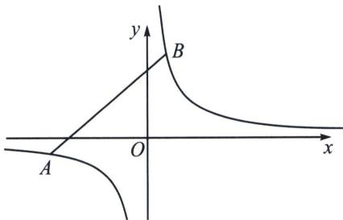

# 反比例函数的两点对合方程

## 2026版高中《mst老唐说题》圆锥曲线专题（数学）

## 二、等轴双曲线与反比例函数转化

如图， $A(x_{1}, y_{1})$ 和 $B(x_{2}, y_{2})$ 分别是反比例函数（等轴双曲线） $y=\frac{m}{x}$ 上的两点，则 AB 的两点对合式方程为： $\frac{x_{1}x_{2}}{m}y+x=x_{1}+x_{2}$ .

证明：由于 $k_{AB} = \frac{\frac{m}{x_1} - \frac{m}{x_2}}{x_1 - x_2} = -\frac{m}{x_1x_2}$ ，故 $AB: y - \frac{m}{x_1} = -\frac{m}{x_1x_2}(x - x_1)$ ，即 $\frac{x_1x_2}{m} y + x = x_1 + x_2$

## 相关原子

- [双曲线的定义与标准方程](%E5%8F%8C%E6%9B%B2%E7%BA%BF%E7%9A%84%E5%AE%9A%E4%B9%89%E4%B8%8E%E6%A0%87%E5%87%86%E6%96%B9%E7%A8%8B.md)
- [直线的点斜式与斜截式方程](%E7%9B%B4%E7%BA%BF%E7%9A%84%E7%82%B9%E6%96%9C%E5%BC%8F%E4%B8%8E%E6%96%9C%E6%88%AA%E5%BC%8F%E6%96%B9%E7%A8%8B.md)

## 所属组织

- [二、等轴双曲线与反比例函数转化](../%E7%9F%A5%E8%AF%86%E4%B8%B2%E8%81%94/mst%E8%80%81%E5%94%90%E8%AF%B4%E9%A2%98-%E5%9C%86%E9%94%A5%E6%9B%B2%E7%BA%BF-2026/%E4%B8%8A%E5%86%8C/%E7%AC%AC04%E7%AB%A0_%E5%B0%8F%E9%A2%98%E6%96%B0%E9%A2%98%E5%9E%8B%E4%B8%8E%E5%A4%9A%E9%80%89%E7%9A%84%E7%BB%BC%E5%90%88%E9%A2%98%E6%96%B9%E6%B3%95%E7%AF%87/%E7%AC%AC%E4%BA%8C%E8%8A%82_%E5%9D%90%E6%A0%87%E6%97%8B%E8%BD%AC%E4%B8%8E%E6%9B%B2%E7%BA%BF%E8%BD%AC%E6%8D%A2/%E4%BA%8C_%E7%AD%89%E8%BD%B4%E5%8F%8C%E6%9B%B2%E7%BA%BF%E4%B8%8E%E5%8F%8D%E6%AF%94%E4%BE%8B%E5%87%BD%E6%95%B0%E8%BD%AC%E5%8C%96/%E4%BA%8C_%E7%AD%89%E8%BD%B4%E5%8F%8C%E6%9B%B2%E7%BA%BF%E4%B8%8E%E5%8F%8D%E6%AF%94%E4%BE%8B%E5%87%BD%E6%95%B0%E8%BD%AC%E5%8C%96.md)

## 题型训练 · 2026版高中《mst老唐说题》圆锥曲线专题（数学）

### 小题新题型与多选的综合题方法篇 / 第二节 坐标旋转与曲线转换

> [!example]- 二、等轴双曲线与反比例函数转化
> 
