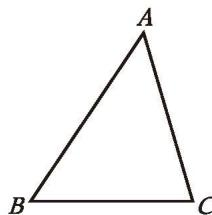

小明的思考过程如下。你能理解他的推理过程吗？

如图 1-20，在 $\triangle ABC$ 中，已知 $\angle B \neq \angle C$ ，此时 AB 与 AC 要么相等，要么不相等。

假设 AB = AC，那么根据定理“等边对等角”可得 $\angle C = \angle B$ ，这

图1-20

与已知条件 $\angle B \neq \angle C$ 相矛盾, 因此 $AB \neq AC$ 。

像小明那样，在证明时，先假设命题的结论不成立，然后推导出与定义、基本事实、已有定理或已知条件相矛盾的结果，从而证明命题的结论一定成立，这种证明方法称为反证法（reduction to absurdity）。
