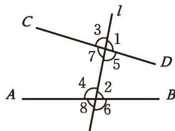

# 同位角概念与平行线判定一（同位角相等，两直线平行）

## 北师大版初中数学·七年级下册

如图 2-17, 具有 $\angle 1$ 与 $\angle 2$ 这样位置关系的角称为同位角 (corresponding angles)。 $\angle 3$ 与 $\angle 4$ 也是同位角。

在图 2-17 中，找出其他的同位角。

图2-17

两条直线被第三条直线所截，如果同位角相等，那么这两条直线平行。

简述为：同位角相等，两直线平行。

两直线平行，用符号“//”表示。例如，直线 $a$ 与直线 $b$ 平行，记作 $a // b$ 。
