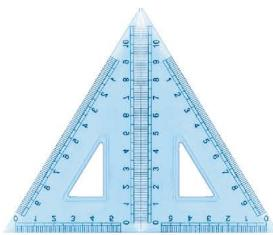
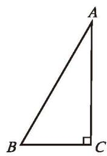
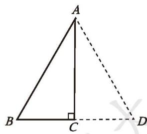

如图 1-21，两个完全相同的含 $30^{\circ}$ 角的三角尺，可以拼成一个等边三角形。由此可以发现： $30^{\circ}$ 角的对边等于三角尺斜边的一半。

图1-21

已知：如图 1-22（1）， $\triangle ABC$ 是直角三角形， $\angle C=90^{\circ}$ ， $\angle A=30^{\circ}$ 。

求证： $BC=\frac{1}{2}AB$ 。

证明：如图 1-22（2），延长 BC 至 D，使 CD = BC，连接 AD。

$$
\because \angle A C B = 90 ^ {\circ}
$$

$$
\therefore \angle A C D = 90 ^ {\circ}
$$

$$
\because A C = A C,
$$

(1)

图1-22

(2)

∴ $\triangle ABC \cong \triangle ADC$ (SAS).

∴ AB = AD (全等三角形的对应边相等),

$\angle BAC = \angle DAC$ （全等三角形的对应角相等）。

$$
\because \angle B A C = 30 ^ {\circ},
$$

$$
\therefore \angle B A D = \angle B A C + \angle D A C = 30 ^ {\circ} + 30 ^ {\circ} = 60 ^ {\circ} 。
$$

$\therefore \triangle ABD$ 是等边三角形（有一个角等于 $60^{\circ}$ 的等腰三角形是等边三角形）。

$$
\therefore B C = \frac {1}{2} B D = \frac {1}{2} A B _ {\circ}
$$

定理 在直角三角形中, 如果一个锐角等于 $30^{\circ}$ , 那么它所对的直角边等于斜边的一半。
