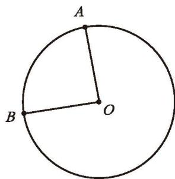

如图 4-35，平面上，一条线段 OA 绕着它固定的一个端点 O 旋转一周，另一个端点 A 所形成的图形叫作圆（circle）。固定的端点 O 称为圆心（center of a circle），线段 OA 称为半径（radius）。

圆上任意两点 A, B 间的部分叫作圆弧，简称弧 (arc)，记作 $\widehat{AB}$ ，读作 “圆弧 AB” 或 “弧 AB”；由一条弧 AB 和经过这条弧的端点的两条半径 OA，OB 所组

图4-35

成的图形叫作扇形（sector）；顶点在圆心的角叫作圆心角（central angle）。
