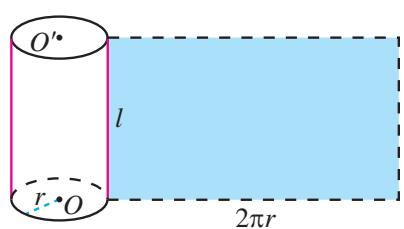
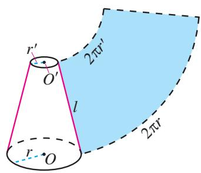

# 圆柱、圆锥、圆台的表面积和体积

## 情境引入与思考

## 知识讲解

### 高中必修 第二册·人教A版数学

与多面体的表面积一样，圆柱、圆锥、圆台的表面积也是围成它的各个面的面积和。利用圆柱、圆锥、圆台的展开图（图8.3-3），可以得到它们的表面积公式：

$S_{圆柱}=2\pi r(r+l)(r$ 是底面半径，l 是母线长），

$S_{圆锥}=\pi r(r+l)(r$ 是底面半径，l 是母线长），

$S_{圆台}=\pi(r'^{2}+r^{2}+r'l+rl)(r',\ r\ 分别是上、下底面半径,\ l\ 是母线长).$

  
图8.3-3

## 本节例题与练习

- [例 3 如图 8.3-4](../%E4%B9%A0%E9%A2%98/Q070000000684.md)
- [例 4 如图8.3-6](../%E4%B9%A0%E9%A2%98/Q070000000685.md)
- [练习 1](../%E4%B9%A0%E9%A2%98/Q070000000686.md)
- [练习 2](../%E4%B9%A0%E9%A2%98/Q070000000687.md)
- [练习 3](../%E4%B9%A0%E9%A2%98/Q070000000688.md)
- [练习 4](../%E4%B9%A0%E9%A2%98/Q070000000689.md)

## 所属组织

- [8.3.2 圆柱、圆锥、圆台、球的表面积和体积](../%E7%9F%A5%E8%AF%86%E4%B8%B2%E8%81%94/%E4%BA%BA%E6%95%99A-%E5%BF%85%E4%BF%AE%E7%AC%AC%E4%BA%8C%E5%86%8C/%E7%AC%AC%E5%85%AB%E7%AB%A0%20%E7%AB%8B%E4%BD%93%E5%87%A0%E4%BD%95%E5%88%9D%E6%AD%A5/8.3%20%E7%AE%80%E5%8D%95%E5%87%A0%E4%BD%95%E4%BD%93%E7%9A%84%E8%A1%A8%E9%9D%A2%E7%A7%AF%E4%B8%8E%E4%BD%93%E7%A7%AF/8.3.2%20%E5%9C%86%E6%9F%B1%E3%80%81%E5%9C%86%E9%94%A5%E3%80%81%E5%9C%86%E5%8F%B0%E3%80%81%E7%90%83%E7%9A%84%E8%A1%A8%E9%9D%A2%E7%A7%AF%E5%92%8C%E4%BD%93%E7%A7%AF.md)

## 相关练习组织（范围关联）

- [8.3.2 圆柱、圆锥、圆台、球的表面积和体积](../%E9%A2%98%E5%9E%8B/%E6%8C%89%E7%AB%A0%E8%8A%82%E5%88%86%E7%B1%BB/%E4%BA%BA%E6%95%99A-%E5%BF%85%E4%BF%AE%E7%AC%AC%E4%BA%8C%E5%86%8C/%E7%AC%AC%E5%85%AB%E7%AB%A0%20%E7%AB%8B%E4%BD%93%E5%87%A0%E4%BD%95%E5%88%9D%E6%AD%A5/8.3%20%E7%AE%80%E5%8D%95%E5%87%A0%E4%BD%95%E4%BD%93%E7%9A%84%E8%A1%A8%E9%9D%A2%E7%A7%AF%E4%B8%8E%E4%BD%93%E7%A7%AF.md)
