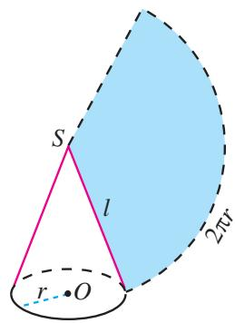

# 圆柱、圆锥、圆台的表面积和体积

## 高中必修 第二册·人教A版数学

与多面体的表面积一样，圆柱、圆锥、圆台的表面积也是围成它的各个面的面积和。利用圆柱、圆锥、圆台的展开图（图8.3-3），可以得到它们的表面积公式：

$S_{圆柱}=2\pi r(r+l)(r$ 是底面半径，l 是母线长），

$S_{圆锥}=\pi r(r+l)(r$ 是底面半径，l 是母线长），

$S_{圆台}=\pi(r'^{2}+r^{2}+r'l+rl)(r',\ r\ 分别是上、下底面半径,\ l\ 是母线长).$

  
图8.3-3

