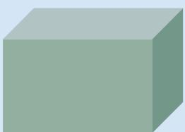
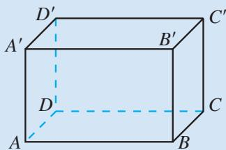
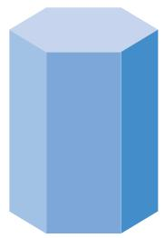
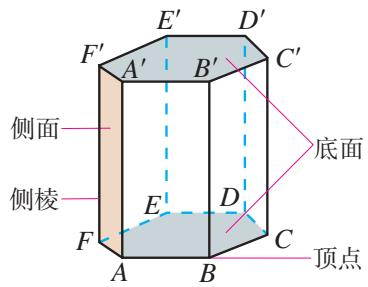
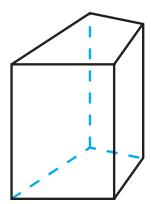
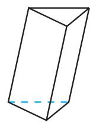
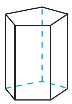
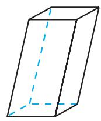

# 圆柱圆锥圆台与球的结构特征

## 高中必修 第二册·人教A版数学

观察

观察图8.1-4中的长方体，它的每个面是什么样的多边形？不同的面之间有什么位置关系？

  
图8.1-4

可以发现，长方体的每个面都是平行四边形（矩形），并且相对的两个面，如面ABCD和面 $A'B'C'D'$ ，给我们以平行的形象，如同教室的地面和天花板一样.

如图8.1-5，一般地，有两个面互相平行，其余各面都是四边形，并且相邻两个四边形的公共边都互相平行，由这些面所围成的多面体叫做棱柱（prism）。图8.1-1中的茶叶盒所表示的多面体就是棱柱。在棱柱中，两个互相平行的面叫做棱柱的底面，它们是全等的多边形；其余各面叫做棱柱的侧面，它们都是平行四边形；相邻侧面的公共边叫做棱柱的侧棱；侧面与底面的公共顶点叫做棱柱的顶点。

  
图8.1-5

棱柱用表示底面各顶点的字母来表示，如图 8.1-5 中的棱柱记作棱柱 ABCDEF-A'B'C'D'E'F'. 棱柱的底面可以是三角形、四边形、五边形……，我们把这样的棱柱分别叫做三棱柱、四棱柱、五棱柱……

在图8.1-4中的长方体中，侧棱和底面给我们以垂直的形象，如同教室里相邻墙面的交线和地面的关系一样。一般地，我们把侧棱垂直于底面的棱柱叫做直棱柱（图8.1-6(1)(3))，侧棱不垂直于底面的棱柱叫做斜棱柱（图8.1-6(2)(4)）。底面是正多边形的直棱柱叫做正棱柱（图8.1-6(3)）。底面是平行四边形的四棱柱也叫做平行六面体（图8.1-6(4)）。

  
(1)

  
(2)

  
图8.1-6  
(3)

  
(4)

## 本节例题与练习

- [习题8.1 复习巩固 第1题](../%E4%B9%A0%E9%A2%98/Q070000000654.md)
- [习题8.1 复习巩固 第2题](../%E4%B9%A0%E9%A2%98/Q070000000655.md)
- [习题8.1 复习巩固 第3题](../%E4%B9%A0%E9%A2%98/Q070000000656.md)
- [习题8.1 复习巩固 第4题](../%E4%B9%A0%E9%A2%98/Q070000000657.md)
- [习题8.1 复习巩固 第5题](../%E4%B9%A0%E9%A2%98/Q070000000658.md)
- [习题8.1 拓广探索 第10题](../%E4%B9%A0%E9%A2%98/Q070000000663.md)
- [习题8.1 综合运用 第6题](../%E4%B9%A0%E9%A2%98/Q070000000659.md)
- [习题8.1 综合运用 第7题](../%E4%B9%A0%E9%A2%98/Q070000000660.md)
- [习题8.1 综合运用 第8题](../%E4%B9%A0%E9%A2%98/Q070000000661.md)
- [习题8.1 综合运用 第9题](../%E4%B9%A0%E9%A2%98/Q070000000662.md)
- [例 1 将下列各类几何体之间的关系用](../%E4%B9%A0%E9%A2%98/Q070000000640.md)
- [练习 1](../%E4%B9%A0%E9%A2%98/Q070000000641.md)
- [练习 1](../%E4%B9%A0%E9%A2%98/Q070000000650.md)
- [练习 2](../%E4%B9%A0%E9%A2%98/Q070000000642.md)
- [练习 2](../%E4%B9%A0%E9%A2%98/Q070000000651.md)
- [练习 3](../%E4%B9%A0%E9%A2%98/Q070000000643.md)
- [练习 3](../%E4%B9%A0%E9%A2%98/Q070000000652.md)
- [练习 4](../%E4%B9%A0%E9%A2%98/Q070000000645.md)
- [练习 4](../%E4%B9%A0%E9%A2%98/Q070000000644.md)
- [练习 4](../%E4%B9%A0%E9%A2%98/Q070000000653.md)
- [练习 5](../%E4%B9%A0%E9%A2%98/Q070000000646.md)
- [练习 6](../%E4%B9%A0%E9%A2%98/Q070000000647.md)
- [练习 7](../%E4%B9%A0%E9%A2%98/Q070000000648.md)
- [练习 8](../%E4%B9%A0%E9%A2%98/Q070000000649.md)

## 所属组织

- [8.1 基本立体图形](../%E7%9F%A5%E8%AF%86%E4%B8%B2%E8%81%94/%E4%BA%BA%E6%95%99A-%E5%BF%85%E4%BF%AE%E7%AC%AC%E4%BA%8C%E5%86%8C/%E7%AC%AC%E5%85%AB%E7%AB%A0%20%E7%AB%8B%E4%BD%93%E5%87%A0%E4%BD%95%E5%88%9D%E6%AD%A5/8.1%20%E5%9F%BA%E6%9C%AC%E7%AB%8B%E4%BD%93%E5%9B%BE%E5%BD%A2/8.1%20%E5%9F%BA%E6%9C%AC%E7%AB%8B%E4%BD%93%E5%9B%BE%E5%BD%A2.md)

## 相关练习组织（范围关联）

- [8.1 基本立体图形](../%E9%A2%98%E5%9E%8B/%E6%8C%89%E7%AB%A0%E8%8A%82%E5%88%86%E7%B1%BB/%E4%BA%BA%E6%95%99A-%E5%BF%85%E4%BF%AE%E7%AC%AC%E4%BA%8C%E5%86%8C/%E7%AC%AC%E5%85%AB%E7%AB%A0%20%E7%AB%8B%E4%BD%93%E5%87%A0%E4%BD%95%E5%88%9D%E6%AD%A5/8.1%20%E5%9F%BA%E6%9C%AC%E7%AB%8B%E4%BD%93%E5%9B%BE%E5%BD%A2.md)
