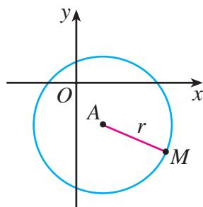

# 圆的标准方程及其推导

## 高中选择性必修 第一册·人教A版数学

我们知道，圆是平面上到定点的距离等于定长的点的集合。在平面直角坐标系中，如果一个圆的圆心坐标和半径确定了，圆就唯一确定了。由此，我们可以建立圆上点的坐标应满足的关系式，进而得到圆的方程。

如图 2.4-1，在平面直角坐标系中， $\odot A$ 的圆心 A 的坐标为 $(a, b)$ ，半径为 r，

$M(x, y)$ 为圆上任意一点， $\odot A$ 就是以下点的集合

$$
P = \{M \mid | M A | = r \}.
$$

根据两点间的距离公式，点 M 的坐标 $(x, y)$ 满足的条件可以表示为

$$
\sqrt {(x - a) ^ {2} + (y - b) ^ {2}} = r,
$$

两边平方，得

图2.4-1

$$
(x - a) ^ {2} + (y - b) ^ {2} = r ^ {2}.\tag{1}
$$

由上述过程可知，若点 $M(x, y)$ 在 $\odot A$ 上，点 M 的坐标就满足方程(1)；反过来，若点 M 的坐标 $(x, y)$ 满足方程(1)，就说明点 M 与圆心 A 间的距离为 r，点 M 就在 $\odot A$ 上．这时，我们把方程(1)称为圆心为 $A(a, b)$ ，半径为 r 的圆的标准方程（standard equation of circle）.
