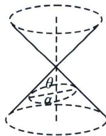

# 圆锥截面与圆锥曲线的类型

## 2026版高中《mst老唐说题》圆锥曲线专题（数学）

## 一、截口曲线形成的圆锥曲线

圆锥曲线就可以看作圆锥被一个平面所截得到的截口曲线.

如图，设圆锥的轴截面顶角为 $2\theta$ ，圆锥的轴与截面所成的角为 $\alpha$ ，其中 $\alpha, \theta \in \left(0, \frac{\pi}{2}\right)$ .

当 $\alpha > \theta$ 时，截口曲线为椭圆，平面两侧的圆锥内切球与平面的切点为两焦点。；当 $\alpha = \theta$ 时，截口曲线为抛物线，平面一侧的圆锥内切球与平面的切点为焦点；当 $\alpha < \theta$ 时，截口曲线为双曲线，平面两侧的圆锥内切球与平面的切点为两焦点.

## 相关原子

- [双曲线的定义与标准方程](%E5%8F%8C%E6%9B%B2%E7%BA%BF%E7%9A%84%E5%AE%9A%E4%B9%89%E4%B8%8E%E6%A0%87%E5%87%86%E6%96%B9%E7%A8%8B.md)
- [抛物线的定义与标准方程](%E6%8A%9B%E7%89%A9%E7%BA%BF%E7%9A%84%E5%AE%9A%E4%B9%89%E4%B8%8E%E6%A0%87%E5%87%86%E6%96%B9%E7%A8%8B.md)
- [椭圆的定义与标准方程](%E6%A4%AD%E5%9C%86%E7%9A%84%E5%AE%9A%E4%B9%89%E4%B8%8E%E6%A0%87%E5%87%86%E6%96%B9%E7%A8%8B.md)

## 所属组织

- [一、截口曲线形成的圆锥曲线](../%E7%9F%A5%E8%AF%86%E4%B8%B2%E8%81%94/mst%E8%80%81%E5%94%90%E8%AF%B4%E9%A2%98-%E5%9C%86%E9%94%A5%E6%9B%B2%E7%BA%BF-2026/%E4%B8%8A%E5%86%8C/%E7%AC%AC01%E7%AB%A0_%E5%9C%86%E9%94%A5%E6%9B%B2%E7%BA%BF%E5%9B%9B%E5%AE%9A%E4%B9%89/%E7%AC%AC%E4%B8%83%E8%8A%82_%E6%88%AA%E5%8F%A3%E6%9B%B2%E7%BA%BF%E4%B8%8E%E7%A5%96%E6%9A%85%E5%8E%9F%E7%90%86/%E4%B8%80_%E6%88%AA%E5%8F%A3%E6%9B%B2%E7%BA%BF%E5%BD%A2%E6%88%90%E7%9A%84%E5%9C%86%E9%94%A5%E6%9B%B2%E7%BA%BF/%E4%B8%80_%E6%88%AA%E5%8F%A3%E6%9B%B2%E7%BA%BF%E5%BD%A2%E6%88%90%E7%9A%84%E5%9C%86%E9%94%A5%E6%9B%B2%E7%BA%BF.md)

## 题型训练 · 2026版高中《mst老唐说题》圆锥曲线专题（数学）

### 圆锥曲线四定义 / 第七节 截口曲线与祖暅原理

> [!example]- 一、截口曲线形成的圆锥曲线
> 
