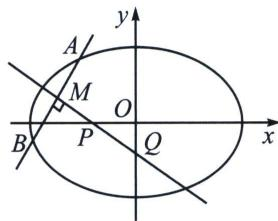
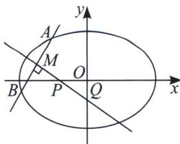
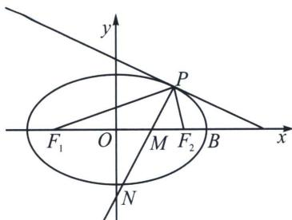
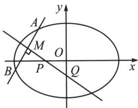

# 圆锥曲线中垂线的截距定理

## 2026版高中《mst老唐说题》圆锥曲线专题（数学）

## 六、中垂线定理与离心率限定

中垂线截距定理: 若 $A 、 B$ 关于直线 $P Q$ 对称, 可以知道线段 $A B$ 被直线 $P Q$ 垂直平分, 其中 $P (n, 0)$ , $Q (0, m)$ 则能得出以下定理(不妨设焦点在 $x$ 轴上):

$m = -\frac{y_0c^2}{b^2}$ （椭圆）， $m = \frac{y_0c^2}{b^2}$ （双曲线）； $n = \frac{x_0c^2}{a^2}$ （椭圆）， $n = \frac{x_0c^2}{a^2}$ （双曲线）.

因为 $k_{AB} \cdot k_{OM} = -\frac{b^2}{a^2}$ （点差法）， $k_{AB} \cdot k_{PQ} = -1$ ，所以 $\frac{k_{OM}}{k_{PQ}} = \frac{b^2}{a^2}$ ，故 $\frac{\frac{y_0}{x_0}}{\frac{y_0 - m}{x_0}} = \frac{b^2}{a^2}$ ，即 $m = -\frac{y_0c^2}{b^2}$ ；同理 $\frac{\frac{y_0}{x_0}}{\frac{y_0}{x_0 - n}} = \frac{b^2}{a^2}$ ，即 $n = \frac{x_0c^2}{a^2}$ .

这是一个可解决大题，也可以解决小题的二级结论，任何一个问题我们需要去理解它的适用范围，如果好用，不妨多往这个方向考虑.

## 三、光学性质与中垂线截距定理

中垂线截距定理：若 A、B 关于直线 PQ 对称，可以知道线段 AB 被直线 PQ 垂直平分，其中 $P(n,0)$ ， $Q(0,m)$ 则能得出以下定理（不妨设焦点在 x 轴上）：

$m = -\frac{y_0c^2}{b^2}$ （椭圆）， $m = \frac{y_0c^2}{b^2}$ （双曲线）； $n = \frac{x_0c^2}{a^2}$ （椭圆）， $n = \frac{x_0c^2}{a^2}$ （双曲线）.

因为 $k_{AB} \cdot k_{OM} = -\frac{b^2}{a^2}$ (第三定义点差法), $k_{AB} \cdot k_{PQ} = -1$ , 所以 $\frac{k_{OM}}{k_{PQ}} = \frac{b^2}{a^2}$ , 故 $\frac{\frac{y_0}{x_0}}{\frac{y_0 - m}{x_0}} = \frac{b^2}{a^2}$ , 即 $m = -\frac{y_0c^2}{b^2}$ ; 同理 $\frac{\frac{y_0}{x_0}}{\frac{y_0}{x_0 - n}} = \frac{b^2}{a^2}$ , 即 $n = \frac{x_0c^2}{a^2}$ .

光学性质中垂线截距定理：

我们可以把切点 $P(x_{0}, y_{0})$ 看成二重点，如图，若 PM 为 $\angle F_{1}PF_{2}$ 平分线，则 $x_{M}=\frac{c^{2}x_{0}}{a^{2}}$ ， $y_{N}=-\frac{c^{2}y_{0}}{b^{2}}$ .

证明: 根据 $PM$ 为角平分线可知 $PM \perp l$ , ( $l$ 是椭圆在点 $P$ 处的切线), $PF_{2}$ 和 $PF_{1}$ 是入射光线和反射光线, 所以 $PM$ 是切线 (切点弦) $l$ 的中垂线 (考虑极限情况, 切点看为两个交点的中点), 故根据中垂线截距定理 $x_{M} = \frac{c^{2} x_{0}}{a^{2}}$ , $y_{N} = -\frac{c^{2} y_{0}}{b^{2}}$ .

## 三、点差法与中垂线问题

如今的考试已经不可能让大家简单背个点差结论就能解决，总会在点差法的基础上加上一点命题逻辑，所以我们找到了常考的第一点——中垂线和对称问题！

中垂线问题: 若 $A 、 B$ 关于直线 $P Q$ 对称, 可以知道线段 $A B$ 被直线 $P Q$ 垂直平分, 其中 $P (n, 0)$ , $Q (0, m)$ 则能得出以下定理(不妨设焦点在 $x$ 轴上):

$m = -\frac{y_0c^2}{b^2}$ （椭圆）， $m = \frac{y_0c^2}{b^2}$ （双曲线）； $m = p + y_0$ （抛物线）；

$n=\frac{x_{0}c^{2}}{a^{2}}$ （椭圆）， $n=\frac{x_{0}c^{2}}{a^{2}}$ （双曲线）。 $n=p+x_{0}$ （抛物线）；

我们这里以焦点在 $x$ 轴上的椭圆为例来证明：

$k_{AB} \cdot k_{OM} = -\frac{b^{2}}{a^{2}}, k_{AB} \cdot k_{PQ} = -1, \frac{k_{OM}}{k_{PQ}} = \frac{b^{2}}{a^{2}}$ ，故 $\frac{\frac{y_{0}}{x_{0}}}{\frac{y_{0}-m}{x_{0}}} = \frac{b^{2}}{a^{2}}$ ，即 $m = -\frac{y_{0}c^{2}}{b^{2}}$ ；同理 $\frac{\frac{y_{0}}{x_{0}}}{\frac{y_{0}}{x_{0}-n}} = \frac{b^{2}}{a^{2}}$ ，即 $n = \frac{x_{0}c^{2}}{a^{2}}$ .

## 相关原子

- [双曲线的定义与标准方程](%E5%8F%8C%E6%9B%B2%E7%BA%BF%E7%9A%84%E5%AE%9A%E4%B9%89%E4%B8%8E%E6%A0%87%E5%87%86%E6%96%B9%E7%A8%8B.md)
- [椭圆的定义与标准方程](%E6%A4%AD%E5%9C%86%E7%9A%84%E5%AE%9A%E4%B9%89%E4%B8%8E%E6%A0%87%E5%87%86%E6%96%B9%E7%A8%8B.md)
- [直线的倾斜角与斜率](%E7%9B%B4%E7%BA%BF%E7%9A%84%E5%80%BE%E6%96%9C%E8%A7%92%E4%B8%8E%E6%96%9C%E7%8E%87.md)

## 题型训练 · 2026版高中《mst老唐说题》圆锥曲线专题（数学）

### 离心率 / 第三节 长度与角度下的离心率范围约束

> [!example]- 六、中垂线定理与离心率限定
> 

### 几何视角下的焦点三角形 / 第二节 几何光学性质下的焦点三角形

> [!example]- 三、光学性质与中垂线截距定理
> 

### 圆锥曲线常规数据处理方法 / 第三节 点差法与中垂线问题

> [!example]- 三、点差法与中垂线问题
> 
