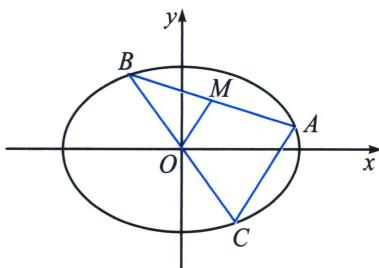
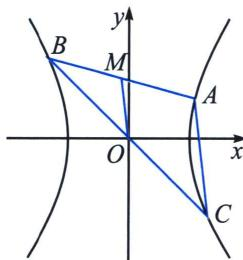
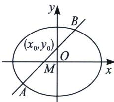

# 圆锥曲线中点弦的斜率关系

## 2026版高中《mst老唐说题》圆锥曲线专题（数学）

## 三、第三定义与中点弦转化

中点弦问题是斜率乘积为定值，其本质来源于第三定义，如图，设 AB 为椭圆 $\frac{x^{2}}{a^{2}} + \frac{y^{2}}{b^{2}} = 1 (a > b > 0)$ 不平行于坐标轴的弦，M 为 AB 的中点，C 是椭圆上一点，且弦 BC 过椭圆的中心 O，利用中位线得： $k_{OM} \cdot k_{AB} = k_{AB} \cdot k_{AC} = -\frac{b^{2}}{a^{2}}$ .

设 AB 为双曲线 $\frac{x^{2}}{a^{2}} - \frac{y^{2}}{b^{2}} = 1 (a > 0, b > 0)$ 不平行于坐标轴的弦，M 为 AB 的中点，C 是双曲线上一点，且弦 BC 过双曲线的中心 O，利用中位线得： $k_{OM} \cdot k_{AB} = k_{AB} \cdot k_{AC} = \frac{b^{2}}{a^{2}}$ .

若双曲线与直线 l 交于 AB 两点，其中 $A(x_{1}, y_{1})$ ， $B(x_{2}, y_{2})$ ， $M(x_{0}, y_{0})$ 为 AB 中点， $k_{AB} \cdot k_{OM} = \frac{b^{2}}{a^{2}}$ 证明：设 $A(x_{1}, y_{1}), B(x_{2}, y_{2}), M(x_{0}, y_{0})$ ，则 $\left\{\begin{aligned}\frac{x_{1}^{2}}{a^{2}}-\frac{y_{1}^{2}}{b^{2}}&=1①\\ \frac{x_{2}^{2}}{a^{2}}-\frac{y_{2}^{2}}{b^{2}}&=1②\\ \frac{x_{1}+x_{2}}{2}&=x_{0}③①-②, 并将③④⑤代入得：k_{AB} \cdot k_{OM}=\frac{y_{1}-y_{2}}{x_{1}-x_{2}} \cdot \frac{y_{1}+y_{2}}{x_{1}+x_{2}}=\frac{y_{1}-y_{2}}{x_{1}-x_{2}} \cdot \frac{y_{0}}{x_{0}}=\frac{b^{2}}{a^{2}}\\ \frac{y_{1}+y_{2}}{2}&=y_{0}④\\ k_{AB}=\frac{y_{2}-y_{1}}{x_{2}-x_{1}}⑤\end{aligned}\right.$

## 一、点差法与中点弦

若椭圆(双曲线)与直线 l 交于 AB 两点，其中 $A(x_{1}, y_{1})$ ， $B(x_{2}, y_{2})$ ， $M(x_{0}, y_{0})$ ，为 AB 中点，定理 1： $k_{AB} \cdot k_{OM} = -\frac{b^{2}}{a^{2}}$ （椭圆）； $k_{AB} \cdot k_{OM} = \frac{b^{2}}{a^{2}}$ （双曲线）

证明：设 $A(x_{1},y_{1})$ ， $B(x_{2},y_{2})$ ， $M(x_0,y_0)$ ，则

\(\begin{array}{r}\left\{\frac{x\_1^2}{a^2} +\frac{y\_1^2}{b^2} = 1① \right.\\ \left.\frac{x\_2^2}{a^2} +\frac{y\_2^2}{b^2} = 1② \right.\right.\\ \left.\frac{x\_1 + x\_2}{2} = x\_0③ \right.\right.\quad 双曲线： \(\left\{\frac{x\_1^2 - y\_1^2}{a^2} = 1① \right.\) \\ \left.\frac{y\_1 + y\_2}{2} = y\_0④ \right.\right.\quad \left.\frac{y\_1 + y\_2}{2} = y\_0④ \right.\) \\ \left.k\_{AB} = \frac{y\_2 - y\_1}{x\_2 - x\_1⑤}\right.\end{array}\)

①-②，并将③④⑤代入得： $k_{AB} \cdot k_{OM} = \frac{y_1 - y_2}{x_1 - x_2} \cdot \frac{y_1 + y_2}{x_1 + x_2} = \frac{y_1 - y_2}{x_1 - x_2} \cdot \frac{y_0}{x_0} = -\frac{b^2}{a^2}$ （椭圆）， $k_{AB} \cdot k_{OM} = \frac{y_1 - y_2}{x_1 - x_2} \cdot \frac{y_1 + y_2}{x_1 + x_2} = \frac{y_1 - y_2}{x_1 - x_2} \cdot \frac{y_0}{x_0} = \frac{b^2}{a^2}$ （双曲线）

点差法，抓住“差中斜”，这样找到了对应关系，由于点差法属于解析几何技巧方法的入门篇，第一次让大家见识到“设而不求”。本内容小题篇就已经介绍，写大题注意步骤即可，也不是什么难题。

## 相关原子

- [双曲线的定义与标准方程](%E5%8F%8C%E6%9B%B2%E7%BA%BF%E7%9A%84%E5%AE%9A%E4%B9%89%E4%B8%8E%E6%A0%87%E5%87%86%E6%96%B9%E7%A8%8B.md)
- [椭圆的定义与标准方程](%E6%A4%AD%E5%9C%86%E7%9A%84%E5%AE%9A%E4%B9%89%E4%B8%8E%E6%A0%87%E5%87%86%E6%96%B9%E7%A8%8B.md)
- [直线的倾斜角与斜率](%E7%9B%B4%E7%BA%BF%E7%9A%84%E5%80%BE%E6%96%9C%E8%A7%92%E4%B8%8E%E6%96%9C%E7%8E%87.md)

## 题型训练 · 2026版高中《mst老唐说题》圆锥曲线专题（数学）

### 圆锥曲线四定义 / 第三节 椭圆双曲的斜率转化（第三定义）

> [!example]- 三、第三定义与中点弦转化
> 

### 小题新题型与多选的综合题方法篇 / 第三节 圆锥曲线之间的交点

> [!example]- 三、由斜率关系和中点弦构造的混合型
> 

### 圆锥曲线常规数据处理方法 / 第三节 点差法与中垂线问题

> [!example]- 一、点差法与中点弦
> 

### 新定义下的面积转化 / 第一节 过焦点弦的面积问题

> [!example]- 二、焦点弦中点连线隐藏定点与面积转化
> 
