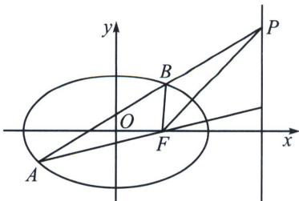
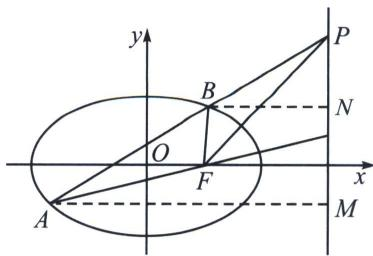
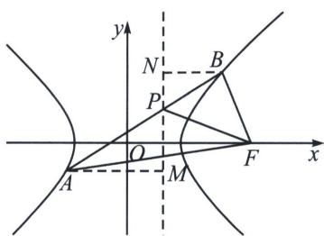

# 圆锥曲线焦准模型的角平分线

## 2026版高中《mst老唐说题》圆锥曲线专题（数学）

## 二、内外角平分线与焦准模型

## 1. 椭圆外角平分线与焦准模型

外角平分线模型设 F 和 l 是圆雉曲线一组对应的焦点和准线，圆雉曲线的弦 AB 交准线 l 于点 M，则 M 到 AF，BF 的距离是相等的，亦即 MF 是 $\angle AFB$ 的内角平分线或者外角平分线.

显然，当且仅当弦 AB 交双曲线于两支时，MF 是 $\angle AFB$ 的内角平分线.

证明: 如图, 过点 $A$ , $B$ 作准线 $l$ 的垂线, 垂足分别为 $M$ , $N$ , 则 $\frac{AF}{BF} = \frac{AM}{BN} = \frac{AP}{PB}$ , 根据外角平分线的逆定理, 所以 $PF$ 平分 $\angle AFB$ 的外角.

## 2. 双曲线内角平分线与焦准模型

证明：如图，过点 A, B 作准线 l 的垂线，垂足分别为 M, N，则 $\frac{AF}{BF} = \frac{AM}{BN} = \frac{AP}{PB}$ ，根据内角平分线的逆定理，所以 PF 平分 $\angle AFB$ 的外角.

## 相关原子

- [双曲线的定义与标准方程](%E5%8F%8C%E6%9B%B2%E7%BA%BF%E7%9A%84%E5%AE%9A%E4%B9%89%E4%B8%8E%E6%A0%87%E5%87%86%E6%96%B9%E7%A8%8B.md)
- [椭圆的定义与标准方程](%E6%A4%AD%E5%9C%86%E7%9A%84%E5%AE%9A%E4%B9%89%E4%B8%8E%E6%A0%87%E5%87%86%E6%96%B9%E7%A8%8B.md)

## 所属组织

- [二、内外角平分线与焦准模型](../%E9%A2%98%E5%9E%8B/%E6%8C%89%E9%A2%98%E5%9E%8B%E5%88%86%E7%B1%BB/%E5%9C%86%E9%94%A5%E6%9B%B2%E7%BA%BF/%E8%B0%83%E5%92%8C%E7%82%B9%E5%88%97%E4%B8%8E%E8%B0%83%E5%92%8C%E7%BA%BF%E6%9D%9F%E5%AE%9A%E7%90%86%E4%B8%8E%E5%AF%B9%E5%90%88%E5%85%B3%E7%B3%BB/%E7%AC%AC%E4%B8%89%E8%8A%82_%E8%A7%92%E5%B9%B3%E5%88%86%E7%BA%BF%E4%B8%8E%E8%B0%83%E5%92%8C%E7%82%B9%E5%88%97/%E4%BA%8C_%E5%86%85%E5%A4%96%E8%A7%92%E5%B9%B3%E5%88%86%E7%BA%BF%E4%B8%8E%E7%84%A6%E5%87%86%E6%A8%A1%E5%9E%8B.md)

## 题型训练 · 2026版高中《mst老唐说题》圆锥曲线专题（数学）

### 调和点列与调和线束定理与对合关系 / 第三节 角平分线与调和点列

> [!example]- 二、内外角平分线与焦准模型
> 
