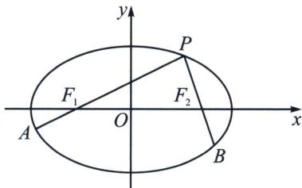

# 圆锥曲线焦弦常数与斜率转化

## 2026版高中《mst老唐说题》圆锥曲线专题（数学）

## 四、利用对称和焦弦常数构造斜率关系

焦弦常数: 设点 $P$ 为椭圆或双曲线上任一点, 过焦点 $F_{1} 、 F_{2}$ 分别作弦 $P A 、 P B$ , 设 $\overrightarrow{P F_{1}} = \lambda \overrightarrow{F_{1} A}, \overrightarrow{P F_{2}} = \mu \overrightarrow{F_{2} B}$ , 则 $\lambda + \mu = \frac{2 (a ^{2} + c ^{2})}{a ^{2} - c ^{2}} = \frac{2 (1 + e ^{2})}{1 - e ^{2}}$ . 证明过程参考例题.

推广：如果将焦点 $F_{1}$ 、 $F_{2}$ 换成 $M_{1}(-m,0)$ 、 $M_{2}(m,0)$ ，则 $\lambda +\mu = \frac{2(a^2 + m^2)}{a^2 - m^2}.$

证明：对 $\left\{\begin{aligned}\overrightarrow{PM_{1}}&=\lambda\overrightarrow{M_{1}}A\\\overrightarrow{PM_{2}}&=\mu\overrightarrow{M_{2}}A\end{aligned}\right.$ ，利用定比点差法易得： $\left\{\begin{aligned}2x_{p}&=-m-\frac{a^{2}}{m}+\left(-m+\frac{a^{2}}{m}\right)\lambda①\\ 2x_{p}&=m+\frac{a^{2}}{m}+\left(m-\frac{a^{2}}{m}\right)\mu②\end{aligned}\right.$

①-②得： $\lambda+\mu=\frac{2(a^{2}+m^{2})}{a^{2}-m^{2}}.$

## 相关原子

- [双曲线的定义与标准方程](%E5%8F%8C%E6%9B%B2%E7%BA%BF%E7%9A%84%E5%AE%9A%E4%B9%89%E4%B8%8E%E6%A0%87%E5%87%86%E6%96%B9%E7%A8%8B.md)
- [椭圆的定义与标准方程](%E6%A4%AD%E5%9C%86%E7%9A%84%E5%AE%9A%E4%B9%89%E4%B8%8E%E6%A0%87%E5%87%86%E6%96%B9%E7%A8%8B.md)

## 所属组织

- [四、利用对称和焦弦常数构造斜率关系](../%E9%A2%98%E5%9E%8B/%E6%8C%89%E9%A2%98%E5%9E%8B%E5%88%86%E7%B1%BB/%E5%9C%86%E9%94%A5%E6%9B%B2%E7%BA%BF/%E4%BB%8E%E5%AE%9A%E6%AF%94%E7%82%B9%E5%B7%AE%E5%88%B0%E6%9E%81%E7%82%B9%E6%9E%81%E7%BA%BF/%E7%AC%AC%E4%B8%89%E8%8A%82_%E8%9D%B4%E8%9D%B6%E5%AE%9A%E7%90%86%E4%B8%8E%E5%9D%8E%E8%BF%AA%E5%AE%9A%E7%90%86/%E5%9B%9B_%E5%88%A9%E7%94%A8%E5%AF%B9%E7%A7%B0%E5%92%8C%E7%84%A6%E5%BC%A6%E5%B8%B8%E6%95%B0%E6%9E%84%E9%80%A0%E6%96%9C%E7%8E%87%E5%85%B3%E7%B3%BB.md)

## 题型训练 · 2026版高中《mst老唐说题》圆锥曲线专题（数学）

### 从定比点差到极点极线 / 第三节 蝴蝶定理与坎迪定理

> [!example]- 四、利用对称和焦弦常数构造斜率关系
> 
