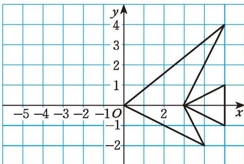

# 坐标变化引起的图案轴对称变换

## 情境引入与思考

## 知识讲解

### 北师大版初中数学·八年级上册

例（1）在平面直角坐标系中依次连接下列各点：(0, 0)，(5, 4)，(3, 0)，(5, 1)，(5, -1)，(3, 0)，(4, -2)，(0, 0)。你得到了一个怎样的图案？

图3-18

(2) 将所得图案的各个 “顶点” 的纵坐标保持不变, 横坐标分别乘 -1 , 依次连接这些点, 你会得到怎样的图案? 这个图案与原图案有怎样的位置关系?

解: (1) 依次连接各点得到的图案如图 3-19 所示, 它像一条小鱼;

图3-19

(2) 纵坐标保持不变, 横坐标分别乘 -1 , 所得各点的坐标依次是 $(0, 0)$ , $(-5, 4)$ , $(-3, 0)$ , $(-5, 1)$ , $(-5, -1)$ , $(-3, 0)$ , $(-4, -2)$ , $(0, 0)$ , 依次连接这些点, 所得图案如图 3-20 所示, 它与原图案关于 $y$ 轴对称。

图3-20

## 本节例题与练习

- [3.3 随堂练习 第1题](../%E4%B9%A0%E9%A2%98/Q070000002506.md)
- [习题 3.3 第1题](../%E4%B9%A0%E9%A2%98/Q070000002507.md)
- [习题 3.3 第2题](../%E4%B9%A0%E9%A2%98/Q070000002508.md)
- [习题 3.3 第3题](../%E4%B9%A0%E9%A2%98/Q070000002509.md)
- [习题 3.3 第4题](../%E4%B9%A0%E9%A2%98/Q070000002510.md)

## 所属组织

- [3 轴对称与坐标变化](../%E7%9F%A5%E8%AF%86%E4%B8%B2%E8%81%94/%E5%8C%97%E5%B8%88%E5%A4%A7-%E5%85%AB%E5%B9%B4%E7%BA%A7%E4%B8%8A%E5%86%8C/%E7%AC%AC%E4%B8%89%E7%AB%A0%20%E4%BD%8D%E7%BD%AE%E4%B8%8E%E5%9D%90%E6%A0%87/3%20%E8%BD%B4%E5%AF%B9%E7%A7%B0%E4%B8%8E%E5%9D%90%E6%A0%87%E5%8F%98%E5%8C%96/%E8%BD%B4%E5%AF%B9%E7%A7%B0%E4%B8%8E%E5%9D%90%E6%A0%87%E5%8F%98%E5%8C%96.md)

## 相关练习组织（范围关联）

- [3 轴对称与坐标变化](../%E9%A2%98%E5%9E%8B/%E6%8C%89%E7%AB%A0%E8%8A%82%E5%88%86%E7%B1%BB/%E5%8C%97%E5%B8%88%E5%A4%A7-%E5%85%AB%E5%B9%B4%E7%BA%A7%E4%B8%8A%E5%86%8C/%E7%AC%AC%E4%B8%89%E7%AB%A0%20%E4%BD%8D%E7%BD%AE%E4%B8%8E%E5%9D%90%E6%A0%87/%E8%BD%B4%E5%AF%B9%E7%A7%B0%E4%B8%8E%E5%9D%90%E6%A0%87%E5%8F%98%E5%8C%96.md)
