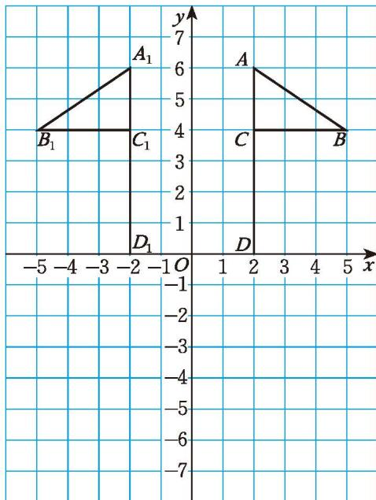
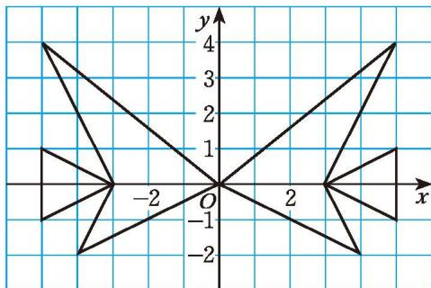

# 坐标变化引起的图案轴对称变换

## 北师大版初中数学·八年级上册

例（1）在平面直角坐标系中依次连接下列各点：(0, 0)，(5, 4)，(3, 0)，(5, 1)，(5, -1)，(3, 0)，(4, -2)，(0, 0)。你得到了一个怎样的图案？

图3-18

(2) 将所得图案的各个 “顶点” 的纵坐标保持不变, 横坐标分别乘 -1 , 依次连接这些点, 你会得到怎样的图案? 这个图案与原图案有怎样的位置关系?

解: (1) 依次连接各点得到的图案如图 3-19 所示, 它像一条小鱼;

图3-19

(2) 纵坐标保持不变, 横坐标分别乘 -1 , 所得各点的坐标依次是 $(0, 0)$ , $(-5, 4)$ , $(-3, 0)$ , $(-5, 1)$ , $(-5, -1)$ , $(-3, 0)$ , $(-4, -2)$ , $(0, 0)$ , 依次连接这些点, 所得图案如图 3-20 所示, 它与原图案关于 $y$ 轴对称。

图3-20
