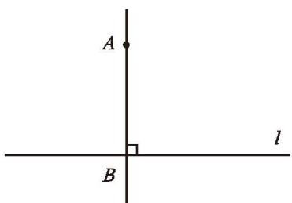

# 垂线的唯一性、垂线段最短与点到直线的距离

## 北师大版初中数学·七年级下册

同一平面内，过一点有且只有一条直线与已知直线垂直。

直线外一点与直线上各点连接的所有线段中，垂线段最短。

如图 2-12, 过点 $A$ 作直线 $l$ 的垂线, 垂足为 $B$ , 线段 $AB$ 的长度叫作点 $A$ 到直线 $l$ 的距离。

图2-12

在图 2-11 中，哪条线段的长度可以表示点 P 到直线 l 的距离？
