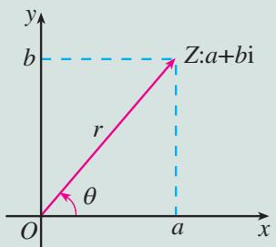

复数 $z = a + b\mathrm{i}\ (a, b \in \mathbf{R})$ 与复平面内的向量 $\overrightarrow{OZ} = (a, b)$ 一一对应，而向量可以由它的大小和方向唯一确定。如图 7.3-1，向量的大小可以用模来刻画，向量的方向可以借助以 $x$ 轴的非负半轴为始边，以向量 $\overrightarrow{OZ}$ 所在射线（射线 $OZ$ ）为终边的角 $\theta$ 来刻画。

  
图7.3-1

记向量的模 $|\overrightarrow{OZ}| = |a + bi| = r$ ，由图7.3-1可以得到，

$$
\left\{ \begin{array}{l} a = r \cos \theta , \\ b = r \sin \theta . \end{array} \right.
$$

所以

$$
a + b \mathrm{i} = r \cos \theta + \mathrm{i} r \sin \theta = r (\cos \theta + \mathrm{i} \sin \theta),
$$

其中

$$
r = \sqrt {a ^ {2} + b ^ {2}},
$$

$$
\cos \theta = \frac {a}{r},
$$

$$
\sin \theta = \frac {b}{r}.
$$

这样，我们就用刻画向量大小的模 $r$ 和刻画向量方向的角 $\theta$ 表示了复数 $z$ .

一般地，任何一个复数 $z = a + bi$ 都可以表示成

$$
r (\cos \theta + \mathrm{i} \sin \theta)
$$

的形式. 其中, $r$ 是复数 $z$ 的模; $\theta$ 是以 $x$ 轴的非负半轴为始边, 向量 $\overrightarrow{OZ}$ 所在射线 (射线 $OZ$ ) 为终边的角, 叫做复数 $z = a + bi$ 的辐角 (argument of a complex number). $r(\cos \theta + \mathrm{i} \sin \theta)$ 叫做复数 $z = a + bi$ 的三角表示式, 简称三角形式. 为了与三角形式区分开来, $a + bi$ 叫做复数的代数表示式, 简称代数形式.

显然，任何一个不为零的复数的辐角有无限多个值，且这些值相差 $2\pi$ 的整数倍。例如，复数i的辐角是 $\frac{\pi}{2} + 2k\pi$ ，其中 $k$ 可以取任何整数。对于复数0，因为它对应着零向量，而零向量的方向是任意的，所以复数0的辐角也是任意的。我们规定在 $0 \leqslant \theta < 2\pi$ 范围内的辐角 $\theta$ 的值为辐角的主值。通常记作 $\arg z$ ，即 $0 \leqslant \arg z < 2\pi$ 。例如， $\arg 1 = 0$ ， $\arg i = \frac{\pi}{2}$ ， $\arg (-1) = \pi$ ， $\arg (-i) = \frac{3\pi}{2}$ 。

复数的代数形式可以转化为三角形式，三角形式也可以转化为代数形式. 我们可以根据运算的需要，将复数的三角形式和代数形式进行互化.

关于两个用三角形式表示的非零复数相等的条件：每一个不等于零的复数有唯一的模与辐角的主值，并且由它的模与辐角的主值唯一确定。因此，两个非零复数相等当且仅当它们的模与辐角的主值分别相等。
