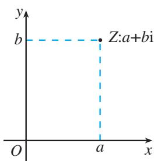
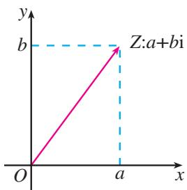

# 复数的几何意义

## 情境引入与思考

## 知识讲解

### 高中必修 第二册·人教A版数学

我们知道，实数与数轴上的点一一对应，因此实数可以用数轴上的点来表示. 复数有什么几何意义呢？

思考

根据复数相等的定义，任何一个复数 $z = a + bi$ 都可以由一个有序实数对 $(a, b)$ 唯一确定；反之也对。由此你能想到复数的几何表示方法吗？

因为任何一个复数 $z = a + b\mathrm{i}$ 都可以由一个有序实数对（ $a, b$ ）唯一确定，并且任给一个复数也可以唯一确定一个有序实数对，所以复数 $z = a + b\mathrm{i}$ 与有序实数对（ $a, b$ ）是一一对应的。而有序实数对（ $a, b$ ）与平面直角坐标系中的点是一一对应的，所以复数集与平面直角坐标系中的点集之间可以建立一一对应关系。

如图 7.1-2，点 Z 的横坐标是 a，纵坐标是 b，复数 $z=a+bi$ 可用点 $Z(a,b)$ 表示。这个建立了直角坐标系来表示复数的平面叫做复平面，x 轴叫做实轴，y 轴叫做虚轴。显然，实轴上的点都表示实数；除了原点外，虚轴上的点都表示纯虚数。

图7.1-2

例如，复平面内的原点（0，0）表示实数0，实轴上的点（2，0）表示实数2，虚轴上的点（0，-1）表示纯虚数-i，点（-2，3）表示复数 $-2+3i$ 等.

按照这种表示方法，每一个复数，有复平面内唯一的一个点和它对应；反过来，复平面内的每一个点，有唯一的一个复数和它对应。由此可知，复数集 C 中的数与复平面内的点按如下方式建立了一一对应关系

$$
\text { 复数 } z = a + b \mathrm{i} \xrightarrow {\text { 一一对应 }} \text { 复平面内的点 } Z (a, b)
$$

这是复数的一种几何意义.

思考

在平面直角坐标系中，每一个平面向量都可以用一个有序实数对来表示，而有序实数对与复数是一一对应的。你能用平面向量来表示复数吗？

如图 7.1-3，设复平面内的点 Z 表示复数 $z=a+bi$ ，连接 OZ，显然向量 $\overrightarrow{OZ}$ 由点 Z 唯一确定；反过来，点 Z 也可以由向量 $\overrightarrow{OZ}$ 唯一确定。因此，复数集 C 中的数与复平面内以原点为起点的向量建立了如下一一对应关系（实数 0 与

  
图7.1-3

零向量对应)，即

$$
\text { 复数 } z = a + b \mathrm{i} \xrightarrow {\text { 一一对应 }} \text { 平面向量 } \overrightarrow {O Z}
$$

这是复数的另一种几何意义.

为方便起见，我们常把复数 $z = a + b\mathrm{i}$ 说成点 $Z$ 或说成向量 $\overrightarrow{OZ}$ ，并且规定，相等的向量表示同一个复数.

在本书的第六章，我们提到复数的这种几何表示是由韦塞尔在1797年提出的。后来，阿尔冈出书对此进行讨论，并得到高斯的认同，因此这种几何表示也称阿尔冈图（Argand diagram）。正是这种直观的几何表示，揭开了复数的神秘的、不可思议的“面纱”，确立了复数在数学中的地位。

图 7.1-3 中向量 $\overline{OZ}$ 的模叫做复数 $z=a+bi$ 的模（modulus of a complex number）或绝对值，记作 $|z|$ 或 $|a+bi|$ 。即

$$
| z | = | a + b \mathrm{i} | = \sqrt {a ^ {2} + b ^ {2}},
$$

其中 $a, b \in \mathbf{R}$ .

如果 $b = 0$ ，那么 $z = a + b\mathrm{i}$ 是一个实数 $a$ ，它的模就等于 $\left|a\right|$ （ $a$ 的绝对值）.

## 先修知识

- [复数的概念与数系扩充](%E5%A4%8D%E6%95%B0%E7%9A%84%E6%A6%82%E5%BF%B5%E4%B8%8E%E6%95%B0%E7%B3%BB%E6%89%A9%E5%85%85.md)

## 后续知识

- [复数的三角表示式](%E5%A4%8D%E6%95%B0%E7%9A%84%E4%B8%89%E8%A7%92%E8%A1%A8%E7%A4%BA%E5%BC%8F.md)

## 本节例题与练习

- [例 2 设复数 $z_{1}=4+3i](../%E4%B9%A0%E9%A2%98/Q070000000563.md)
- [例 3 设 $z \in \mathb](../%E4%B9%A0%E9%A2%98/Q070000000564.md)
- [练习 1](../%E4%B9%A0%E9%A2%98/Q070000000565.md)
- [练习 2](../%E4%B9%A0%E9%A2%98/Q070000000566.md)
- [练习 3](../%E4%B9%A0%E9%A2%98/Q070000000567.md)

## 所属组织

- [7.1.2 复数的几何意义](../%E7%9F%A5%E8%AF%86%E4%B8%B2%E8%81%94/%E4%BA%BA%E6%95%99A-%E5%BF%85%E4%BF%AE%E7%AC%AC%E4%BA%8C%E5%86%8C/%E7%AC%AC%E4%B8%83%E7%AB%A0%20%E5%A4%8D%E6%95%B0/7.1%20%E5%A4%8D%E6%95%B0%E7%9A%84%E6%A6%82%E5%BF%B5/7.1.2%20%E5%A4%8D%E6%95%B0%E7%9A%84%E5%87%A0%E4%BD%95%E6%84%8F%E4%B9%89.md)

## 相关练习组织（范围关联）

- [7.1.2 复数的几何意义](../%E9%A2%98%E5%9E%8B/%E6%8C%89%E7%AB%A0%E8%8A%82%E5%88%86%E7%B1%BB/%E4%BA%BA%E6%95%99A-%E5%BF%85%E4%BF%AE%E7%AC%AC%E4%BA%8C%E5%86%8C/%E7%AC%AC%E4%B8%83%E7%AB%A0%20%E5%A4%8D%E6%95%B0/7.1%20%E5%A4%8D%E6%95%B0%E7%9A%84%E6%A6%82%E5%BF%B5.md)
