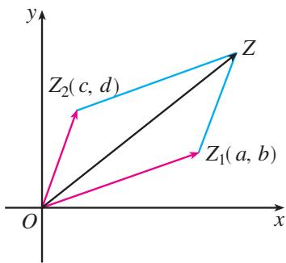

# 复数的加减运算与几何意义

## 情境引入与思考

## 知识讲解

### 高中必修 第二册·人教A版数学

思考

复数的加法满足交换律、结合律吗？

容易得到，对任意 $z_{1}, z_{2}, z_{3} \in \mathbf{C}$ ，有

$$
z _ {1} + z _ {2} = z _ {2} + z _ {1},
$$

$$
(z _ {1} + z _ {2}) + z _ {3} = z _ {1} + (z _ {2} + z _ {3}).
$$

探究

我们知道，复数与复平面内以原点为起点的向量一一对应。而我们讨论过向量加法的几何意义，你能由此出发讨论复数加法的几何意义吗？

设 $\overrightarrow{OZ_1}$ ， $\overrightarrow{OZ_2}$ 分别与复数 $a + bi$ ， $c + di$ 对应，则 $\overrightarrow{OZ_1} = (a,b)$ ， $\overrightarrow{OZ_2} = (c,d)$ ．由平面向量的坐标运算法则，得

$$
\overrightarrow {O Z _ {1}} + \overrightarrow {O Z _ {2}} = (a + c, b + d).
$$

这说明两个向量 $\overrightarrow{OZ_{1}}$ 与 $\overrightarrow{OZ_{2}}$ 的和就是与复数 $(a+c)+(b+d)$ i对应的向量.因此，复数的加法可以按照向量的加法来进行（图7.2-1），这就是复数加法的几何意义.

  
图7.2-1

思考

我们知道，实数的减法是加法的逆运算。类比实数减法的意义，你认为该如何定义复数的减法？

我们规定，复数的减法是加法的逆运算，即把满足

$$
(c + d \mathrm{i}) + (x + y \mathrm{i}) = a + b \mathrm{i}
$$

的复数 $x + y\mathrm{i}(x,y\in \mathbf{R})$ 叫做复数 $a + b\mathrm{i}(a,b\in \mathbf{R})$ 减去复数 $c + d\mathrm{i}(c,d\in \mathbf{R})$ 的差，记作 $(a + b\mathrm{i}) - (c + d\mathrm{i})$

根据复数相等的含义，

$$
c + x = a, d + y = b,
$$

因此

$$
x = a - c, y = b - d,
$$

所以

$$
x + y \mathrm{i} = (a - c) + (b - d) \mathrm{i},
$$

即

$$
(a + b \mathrm{i}) - (c + d \mathrm{i}) = (a - c) + (b - d) \mathrm{i}.
$$

这就是复数的减法法则. 由此可见, 两个复数的差是一个确定的复数. 可以看出, 两个复数相减, 类似于两个多项式相减.

## 本节例题与练习

- [例 1 计算 $(5-6i)+(-2-](../%E4%B9%A0%E9%A2%98/Q070000000579.md)
- [例 2 根据复数及其运算的几何意义](../%E4%B9%A0%E9%A2%98/Q070000000580.md)
- [练习 1](../%E4%B9%A0%E9%A2%98/Q070000000581.md)
- [练习 2](../%E4%B9%A0%E9%A2%98/Q070000000582.md)
- [练习 3](../%E4%B9%A0%E9%A2%98/Q070000000583.md)
- [练习 4](../%E4%B9%A0%E9%A2%98/Q070000000584.md)

## 所属组织

- [7.2.1 复数的加、减运算及其几何意义](../%E7%9F%A5%E8%AF%86%E4%B8%B2%E8%81%94/%E4%BA%BA%E6%95%99A-%E5%BF%85%E4%BF%AE%E7%AC%AC%E4%BA%8C%E5%86%8C/%E7%AC%AC%E4%B8%83%E7%AB%A0%20%E5%A4%8D%E6%95%B0/7.2%20%E5%A4%8D%E6%95%B0%E7%9A%84%E5%9B%9B%E5%88%99%E8%BF%90%E7%AE%97/7.2.1%20%E5%A4%8D%E6%95%B0%E7%9A%84%E5%8A%A0%E3%80%81%E5%87%8F%E8%BF%90%E7%AE%97%E5%8F%8A%E5%85%B6%E5%87%A0%E4%BD%95%E6%84%8F%E4%B9%89.md)

## 相关练习组织（范围关联）

- [7.2.1 复数的加、减运算及其几何意义](../%E9%A2%98%E5%9E%8B/%E6%8C%89%E7%AB%A0%E8%8A%82%E5%88%86%E7%B1%BB/%E4%BA%BA%E6%95%99A-%E5%BF%85%E4%BF%AE%E7%AC%AC%E4%BA%8C%E5%86%8C/%E7%AC%AC%E4%B8%83%E7%AB%A0%20%E5%A4%8D%E6%95%B0/7.2%20%E5%A4%8D%E6%95%B0%E7%9A%84%E5%9B%9B%E5%88%99%E8%BF%90%E7%AE%97.md)
