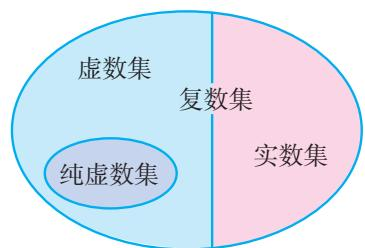

# 复数的概念与数系扩充

## 高中必修 第二册·人教A版数学

在解决求判别式小于 0 的实系数一元二次方程根的问题时，一个自然的想法是，能否像引进无理数而把有理数集扩充到实数集那样，通过引进新的数而使实数集得到扩充，从而使方程变得可解呢？复数概念的引入与这种想法直接相关.

从方程的角度看，负实数能不能开平方，就是方程 $x^{2}+a=0\quad(a>0)$ 有没有解，进而可以归结为方程 $x^{2}+1=0$ 有没有解.

想一想，这是为什么？

探究

我们知道，方程 $x^{2} + 1 = 0$ 在实数集中无解. 联系从自然数集到实数集的扩充过程，你能给出一种方法，适当扩充实数集，使这个方程有解吗？

回顾已有的数集扩充过程，可以看到，每一次扩充都与实际需求密切相关。例如，为了解决正方形对角线的度量，以及 $x^{2} - 2 = 0$ 这样的方程在有理数集中无解的问题，人们把有理数集扩充到了实数集。数集扩充后，在实数集中规定的加法运算、乘法运算，与原来在有理数集中规定的加法运算、乘法运算协调一致，并且加法和乘法都满足交换律和结合律，乘法对加法满足分配律。

依照这种思想，为了解决 $x^{2}+1=0$ 这样的方程在实数系中无解的问题，我们设想引入一个新数 i，使得 x=i 是方程 $x^{2}+1=0$ 的解，即使得 $i^{2}=-1$ .

i 是数学家欧拉（Leonhard Euler，1707—1783）最早引入的，它取自 imaginary（想象的，假想的）一词的词头. $i^{2}=i\cdot i$ .

思考

把新引进的数i添加到实数集中，我们希望数i和实数之间仍然能像实数那样进行加法和乘法运算，并希望加法和乘法都满足交换律、结合律，以及乘法对加法满足分配律.那么，实数系经过扩充后，得到的新数系由哪些数组成呢？

依照以上设想，把实数 b 与 i 相乘，结果记作 bi；把实数 a 与 bi 相加，结果记作 $a + bi$ 。注意到所有实数以及 i 都可以写成 $a + bi (a, b \in \mathbb{R})$ 的形式，从而这些数都在扩充后的新数集中。

我们把形如 $a + bi(a, b \in \mathbf{R})$ 的数叫做复数（complex number），其中 i 叫做虚数单位（imaginary unit）。全体复数构成的集合 $\mathbf{C} = \{a + bi \mid a, b \in \mathbf{R}\}$ 叫做复数集（set of complex numbers）。这样，方程 $x^2 + 1 = 0$ 在复数集 C 中就有解 $x = i$ 了。

复数通常用字母 $z$ 表示，即 $z = a + b\mathrm{i}(a, b \in \mathbf{R})$ 。以后不作特殊说明时，复数 $z = a + b\mathrm{i}$ 都有 $a, b \in \mathbf{R}$ ，其中的 $a$ 与 $b$ 分别叫做复数 $z$ 的实部（real part）与虚部（imaginary part）。

在复数集 $\mathbf{C} = \{a + b\mathrm{i}\mid a,b\in \mathbf{R}\}$ 中任取两个数 $a + b\mathrm{i},c + d\mathrm{i}(a,b,c,d\in \mathbf{R})$ ，我们规定：

$a + bi$ 与 $c + di$ 相等当且仅当 $a = c$ 且 $b = d$ .

对于复数 $a + b\mathrm{i}$ （ $a, b \in \mathbf{R}$ ），当且仅当 $b = 0$ 时，它是实数；当且仅当 $a = b = 0$ 时，它是实数0；当 $b \neq 0$ 时，它叫做虚数（imaginary number）；当 $a = 0$ 且 $b \neq 0$ 时，它叫做纯虚数.

例如， $3 + 2\mathrm{i}$ ， $\frac{1}{2} -\sqrt{3}\mathrm{i}, - \sqrt{3} -\frac{1}{2}\mathrm{i}, - 0.2\mathrm{i}$ 都是虚数，它们的实部分别是 $3,\frac{1}{2},$ $-\sqrt{3},0$ ，虚部分别是 $2, - \sqrt{3}, - \frac{1}{2}, - 0.2$ ，并且其中只有-0.2i是纯虚数.

思考

复数集 C 与实数集 R 之间有什么关系?

显然，实数集 R 是复数集 C 的真子集，即 $R \subsetneq C$ .

这样，复数 $z=a+bi\ (a,\ b\in\mathbf{R})$ 可以分类如下：

复数 $\left\{\begin{aligned}&实数(b=0),\\ &虚数(b\neq0)(当a=0时为纯虚数).\end{aligned}\right.$

复数集、实数集、虚数集、纯虚数集之间的关系，可用图 7.1-1 表示.

图7.1-1
