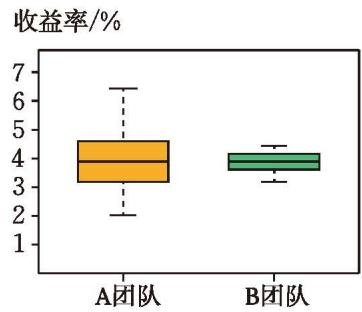

# 多角度综合分析比较两组数据整体水平的方法对比

## 北师大版初中数学·八年级上册

小明利用平均数、方差进行分析。

$\overline{x}_{\mathrm{A}} \approx 3.8617\%$ ， $\overline{x}_{\mathrm{B}} \approx 3.8633\%$ ，可以看出，B团队的平均收益率略高； $s_{\mathrm{A}}^{2} \approx 1.3269$ ， $s_{\mathrm{B}}^{2} \approx 0.1165$ ，可以看出，B团队收益率的波动较小。

通过分析可以看出，B 团队要比 A 团队经营得略好一些，且更为稳健。

小颖利用四分位数、箱线图（如图 6-13）进行分析。

<table><tr><td rowspan="2">团队</td><td colspan="5">最小值、四分位数和最大值</td></tr><tr><td>最小值</td><td> $m_{25}$ </td><td> $m_{50}$ </td><td> $m_{75}$ </td><td>最大值</td></tr><tr><td>A</td><td>2.020</td><td>3.195</td><td>3.915</td><td>4.440</td><td>6.440</td></tr><tr><td>B</td><td>3.180</td><td>3.635</td><td>3.890</td><td>4.125</td><td>4.440</td></tr></table>

图6-13

基于四分位数或箱线图，可以发现 A 团队收益率的中位数与 B 团队的相差不大，但 A 团队的收益率明显比 B 团队的波动大。两个团队经营效益基本一样，但 B 团队的经营水平比 A 团队要平稳。

比较两组数据的整体情况，方法多样。可以借助平均数和方差反映数据的集中趋势和离散程度，也可以借助四分位数和箱线图直观反映数据的分布情况。
