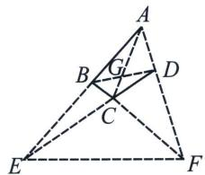
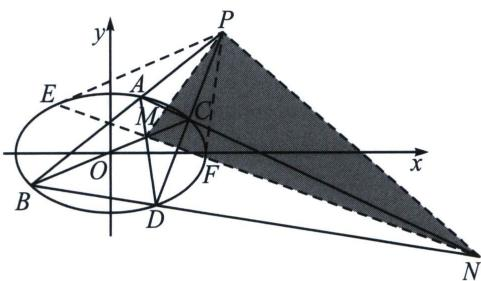

# 完全四边形与自极三角形

## 2026版高中《mst老唐说题》圆锥曲线专题（数学）

## 四、完全四边形与自极三角形

## 1. 完全四边形定义

完全四边形两两相交, 如下图的四边形 $ABCD$ , 没有三线共点的四条直线 $AB$ 、 $BC$ 、 $CD$ 、 $DA$ , 及它们的六个交点, $ABE$ , $ADF$ , $BCF$ , $DCE$ 两两相交于 $A$ , $B$ , $C$ , $D$ , $E$ , $F$ 六点, 六个点可分成三对相对的顶点, 它们的连线 $AC$ , $BD$ , $EF$ 是三条对角线. 则 $ABCDEF$ 即为完全四边形

## 2. 极点极线的综合模型——自极三角形

极点极线的几何意义：

(1)若点 P 是圆锥曲线上的点，则过点 P 的切线即为极点 p 对应的极线.

(2)如图所示(以椭圆图形为例), 若点 $P$ 是不在圆锥曲线上的点, 且不为原点 $O$ , 过点 $P$ 作割线 $PAB$ 、 $PCD$ 依次交圆锥曲线于 $A$ 、 $B$ 、 $C$ 、 $D$ 四点, 连结直线 $AD$ 、 $BC$ 交于点 $M$ , 连结直线 $AC$ 、 $BD$ 交于点 $N$ , 则直线 $l_{MN}$ 为极点 $P$ 对应的极线. 类似的, 也可得到极点 $N$ 对应的极线为直线 $l_{PM}$ , 极点 $M$ 对应的极线为直线 $l_{PN}$ , 因此, 我们把 $\triangle PMN$ 称为自极三角形. 【即 $\triangle PMN$ 的任一顶点作为极点, 则顶点对应的边即为对应的极线, “补全自极三角形”这个技巧很常用, 后面结合例题了解!】

如图所示, 如果我们连结直线 $NM$ 交圆锥曲线于点 $E 、 F$ , 则直线 $PE 、 PF$ 恰好为圆锥曲线的两条切线, 此时, 直线 $l_{EF}$ 不仅是极点 $P$ 的极线, 我们也称直线 $l_{EF}$ 为渐切线.

下面的共轭点模型，实际都是极点在坐标轴上的特例模型的应用，也是高考题常见.

## 相关原子

- [双曲线的定义与标准方程](%E5%8F%8C%E6%9B%B2%E7%BA%BF%E7%9A%84%E5%AE%9A%E4%B9%89%E4%B8%8E%E6%A0%87%E5%87%86%E6%96%B9%E7%A8%8B.md)
- [抛物线的定义与标准方程](%E6%8A%9B%E7%89%A9%E7%BA%BF%E7%9A%84%E5%AE%9A%E4%B9%89%E4%B8%8E%E6%A0%87%E5%87%86%E6%96%B9%E7%A8%8B.md)
- [椭圆的定义与标准方程](%E6%A4%AD%E5%9C%86%E7%9A%84%E5%AE%9A%E4%B9%89%E4%B8%8E%E6%A0%87%E5%87%86%E6%96%B9%E7%A8%8B.md)

## 所属组织

- [四、完全四边形与自极三角形](../%E7%9F%A5%E8%AF%86%E4%B8%B2%E8%81%94/mst%E8%80%81%E5%94%90%E8%AF%B4%E9%A2%98-%E5%9C%86%E9%94%A5%E6%9B%B2%E7%BA%BF-2026/%E4%B8%8B%E5%86%8C/%E7%AC%AC11%E7%AB%A0_%E4%BB%8E%E5%AE%9A%E6%AF%94%E7%82%B9%E5%B7%AE%E5%88%B0%E6%9E%81%E7%82%B9%E6%9E%81%E7%BA%BF/%E7%AC%AC%E4%BA%8C%E8%8A%82_%E6%9E%81%E7%82%B9%E6%9E%81%E7%BA%BF%E5%AE%9A%E4%B9%89%E4%B8%8E%E8%87%AA%E6%9E%81%E4%B8%89%E8%A7%92%E5%BD%A2/%E5%9B%9B_%E5%AE%8C%E5%85%A8%E5%9B%9B%E8%BE%B9%E5%BD%A2%E4%B8%8E%E8%87%AA%E6%9E%81%E4%B8%89%E8%A7%92%E5%BD%A2/%E5%9B%9B_%E5%AE%8C%E5%85%A8%E5%9B%9B%E8%BE%B9%E5%BD%A2%E4%B8%8E%E8%87%AA%E6%9E%81%E4%B8%89%E8%A7%92%E5%BD%A2.md)

## 题型训练 · 2026版高中《mst老唐说题》圆锥曲线专题（数学）

### 从定比点差到极点极线 / 第二节 极点极线定义与自极三角形

> [!example]- 四、完全四边形与自极三角形
> 
