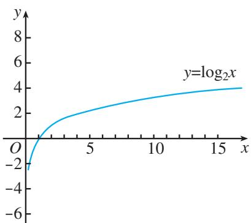
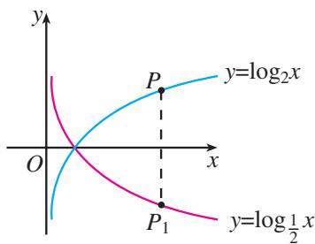
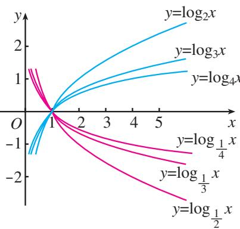
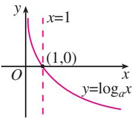
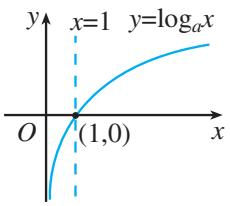

# 对数函数的图象与性质

## 知识讲解

与研究指数函数一样，我们首先画出其图象，然后借助图象研究其性质.

不妨先画函数 $y=\log_{2}x$ 的图象.

请同学们完成 $x$ ， $y$ 的对应值表4.4-1，并用描点法画出函数 $y = \log_2x$ 的图象（图4.4-2).

表4.4-1

<table><tr><td>x</td><td>y</td></tr><tr><td>0.5</td><td>-1</td></tr><tr><td>1</td><td>0</td></tr><tr><td>2</td><td>1</td></tr><tr><td>4</td><td></td></tr><tr><td>6</td><td></td></tr><tr><td>8</td><td></td></tr><tr><td>12</td><td></td></tr><tr><td>16</td><td></td></tr></table>

  
图4.4-2

我们知道，底数互为倒数的两个指数函数的图象关于 $y$ 轴对称。对于底数互为倒数的两个对数函数，比如 $y = \log_2 x$ 和 $y = \log_{\frac{1}{2}} x$ ，它们的图象是否也有某种对称关系呢？可否利用其中一个函数的图象画出另一个函数的图象？

利用换底公式，可以得到 $y = \log_{\frac{1}{2}}x = -\log_2x$ 。因为点 $(x, y)$ 与点 $(x, -y)$ 关于 $x$ 轴对称，所以 $y = \log_2x$ 图象上任意一点 $P(x, y)$ 关于 $x$ 轴的对称点 $P_1(x, -y)$ 都在 $y = \log_{\frac{1}{2}}x$ 的图象上，反之亦然。由此可知，底数互为倒数的两个对数函数的图象关于 $x$ 轴对称。根据这种对称性，就可以利用 $y = \log_2x$ 的图象画出 $y = \log_{\frac{1}{2}}x$ 的图象（图4.4-3）。

  
图4.4-3

为了得到对数函数 $y = \log_a x (a > 0$ ，且 $a \neq 1)$ 的性质，我们还需要画出更多具体对数函数的图象进行观察.
探究

选取底数 $a(a > 0$ ，且 $a \neq 1)$ 的若干个不同的值，在同一直角坐标系内画出相应的对数函数的图象。观察这些图象的位置、公共点和变化趋势，它们有哪些共性？由此你能概括出对数函数 $y = \log_a x (a > 0$ ，且 $a \neq 1)$ 的值域和性质吗？

如图4.4-4，选取底数 $a$ 的若干值，用计算工具画图，发现对数函数 $y = \log_a x$ 的图象按底数 $a$ 的取值，可分为 $0 < a < 1$ 和 $a > 1$ 两种类型。因此，对数函数的性质也可以分 $0 < a < 1$ 和 $a > 1$ 两种情况进行研究。

一般地，对数函数的图象和性质如表 4.4-2 所示.

表4.4-2  

<table><tr><td>项目</td><td>0&lt;a&lt;1</td><td>a&gt;1</td></tr><tr><td>图象</td><td></td><td></td></tr><tr><td>定义域</td><td colspan="2">(0,+∞)</td></tr><tr><td>值域</td><td colspan="2">R</td></tr><tr><td rowspan="2">性质</td><td colspan="2">(1)过定点(1,0),即x=1时,y=0</td></tr><tr><td>(2)减函数</td><td>(2)增函数</td></tr></table>

图4.4-4

## 先修知识

- [对数函数的概念](%E5%AF%B9%E6%95%B0%E5%87%BD%E6%95%B0%E7%9A%84%E6%A6%82%E5%BF%B5--000049.md)

## 本节例题与练习

- [例 3 比较下列各题中两个值的大小:](../%E4%B9%A0%E9%A2%98/Q16272170926554226538.md)
- [例 4 溶液酸碱度的测量.](../%E4%B9%A0%E9%A2%98/Q16511505151748048842.md)
- [练习 1](../%E4%B9%A0%E9%A2%98/Q1514307444092541986.md)
- [练习 2](../%E4%B9%A0%E9%A2%98/Q4216764538373827291.md)
- [练习 3](../%E4%B9%A0%E9%A2%98/Q12949978753404643486.md)

## 所属组织

- [4.4.2 对数函数的图象和性质](../%E7%9F%A5%E8%AF%86%E4%B8%B2%E8%81%94/%E4%BA%BA%E6%95%99A-%E5%BF%85%E4%BF%AE%E7%AC%AC%E4%B8%80%E5%86%8C/%E7%AC%AC%E5%9B%9B%E7%AB%A0%20%E6%8C%87%E6%95%B0%E5%87%BD%E6%95%B0%E4%B8%8E%E5%AF%B9%E6%95%B0%E5%87%BD%E6%95%B0/4.4%20%E5%AF%B9%E6%95%B0%E5%87%BD%E6%95%B0/4.4.2%20%E5%AF%B9%E6%95%B0%E5%87%BD%E6%95%B0%E7%9A%84%E5%9B%BE%E8%B1%A1%E5%92%8C%E6%80%A7%E8%B4%A8.md)

## 相关练习组织（范围关联）

- [4.4.2 对数函数的图象和性质](../%E9%A2%98%E5%9E%8B/%E4%BA%BA%E6%95%99A-%E5%BF%85%E4%BF%AE%E7%AC%AC%E4%B8%80%E5%86%8C/%E7%AC%AC%E5%9B%9B%E7%AB%A0%20%E6%8C%87%E6%95%B0%E5%87%BD%E6%95%B0%E4%B8%8E%E5%AF%B9%E6%95%B0%E5%87%BD%E6%95%B0/4.4%20%E5%AF%B9%E6%95%B0%E5%87%BD%E6%95%B0/4.4.2%20%E5%AF%B9%E6%95%B0%E5%87%BD%E6%95%B0%E7%9A%84%E5%9B%BE%E8%B1%A1%E5%92%8C%E6%80%A7%E8%B4%A8.md)

## 知识整理校核记录

- 对照原PDF第140页核实表4.4-2，恢复被OCR吞掉的底数条件0<a<1；保持其他表格内容。
