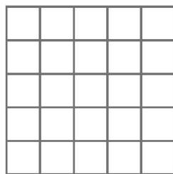

# 对有理数概念扩充与实数系统再认识探究

## 北师大版初中数学·八年级上册

21. 在“有理数及其运算”一章中曾把整数和分数统称为有理数。学习了本章后，你对有理数的概念有哪些新的认识？请将你的认识写成一篇小短文。

(第20题)

## 本节例题与练习

- [第二章 复习题 第10题](../%E4%B9%A0%E9%A2%98/Q070000002468.md)
- [第二章 复习题 第11题](../%E4%B9%A0%E9%A2%98/Q070000002469.md)
- [第二章 复习题 第12题](../%E4%B9%A0%E9%A2%98/Q070000002470.md)
- [第二章 复习题 第13题](../%E4%B9%A0%E9%A2%98/Q070000002471.md)
- [第二章 复习题 第14题](../%E4%B9%A0%E9%A2%98/Q070000002472.md)
- [第二章 复习题 第15题](../%E4%B9%A0%E9%A2%98/Q070000002473.md)
- [第二章 复习题 第16题](../%E4%B9%A0%E9%A2%98/Q070000002474.md)
- [第二章 复习题 第17题](../%E4%B9%A0%E9%A2%98/Q070000002475.md)
- [第二章 复习题 第18题](../%E4%B9%A0%E9%A2%98/Q070000002476.md)
- [第二章 复习题 第19题](../%E4%B9%A0%E9%A2%98/Q070000002477.md)
- [第二章 复习题 第1题](../%E4%B9%A0%E9%A2%98/Q070000002459.md)
- [第二章 复习题 第20题](../%E4%B9%A0%E9%A2%98/Q070000002478.md)
- [第二章 复习题 第22题](../%E4%B9%A0%E9%A2%98/Q070000002479.md)
- [第二章 复习题 第2题](../%E4%B9%A0%E9%A2%98/Q070000002460.md)
- [第二章 复习题 第3题](../%E4%B9%A0%E9%A2%98/Q070000002461.md)
- [第二章 复习题 第4题](../%E4%B9%A0%E9%A2%98/Q070000002462.md)
- [第二章 复习题 第5题](../%E4%B9%A0%E9%A2%98/Q070000002463.md)
- [第二章 复习题 第6题](../%E4%B9%A0%E9%A2%98/Q070000002464.md)
- [第二章 复习题 第7题](../%E4%B9%A0%E9%A2%98/Q070000002465.md)
- [第二章 复习题 第8题](../%E4%B9%A0%E9%A2%98/Q070000002466.md)
- [第二章 复习题 第9题](../%E4%B9%A0%E9%A2%98/Q070000002467.md)

## 所属组织

- [复习题](../%E7%9F%A5%E8%AF%86%E4%B8%B2%E8%81%94/%E5%8C%97%E5%B8%88%E5%A4%A7-%E5%85%AB%E5%B9%B4%E7%BA%A7%E4%B8%8A%E5%86%8C/%E7%AC%AC%E4%BA%8C%E7%AB%A0%20%E5%AE%9E%E6%95%B0/%E5%A4%8D%E4%B9%A0%E9%A2%98.md)

## 相关练习组织（范围关联）

- [复习题](../%E9%A2%98%E5%9E%8B/%E6%8C%89%E7%AB%A0%E8%8A%82%E5%88%86%E7%B1%BB/%E5%8C%97%E5%B8%88%E5%A4%A7-%E5%85%AB%E5%B9%B4%E7%BA%A7%E4%B8%8A%E5%86%8C/%E7%AC%AC%E4%BA%8C%E7%AB%A0%20%E5%AE%9E%E6%95%B0/%E5%A4%8D%E4%B9%A0%E9%A2%98.md)
