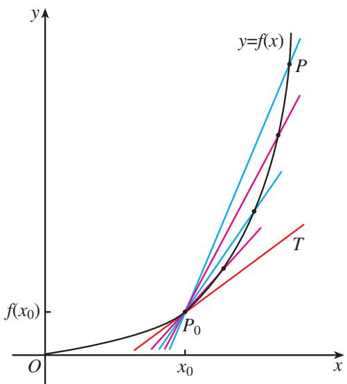
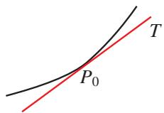
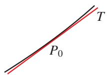
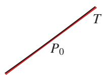

容易发现，平均变化率

$$
\frac {\Delta y}{\Delta x} = \frac {f (x _ {0} + \Delta x) - f (x _ {0})}{\Delta x}
$$

表示割线 $P_{0}P$ 的斜率.

如图 5.1-4，在曲线 $y = f(x)$ 上任取一点 $P(x, f(x))$ ，如果当点 $P(x, f(x))$ 沿着曲线 $y = f(x)$ 无限趋近于点 $P_{0}(x_{0}, f(x_{0}))$ 时，割线 $P_{0}P$ 无限趋近于一个确定的位置，这个确定位置的直线 $P_{0}T$ 称为曲线 $y = f(x)$ 在点 $P_{0}$ 处的切线（tangent line）.

此处的切线定义与初中学过的圆的切线定义有什么不同？

  
图5.1-4

利用信息技术工具，演示图5.1-4中 $P_0P$ 的动态变化效果．做一做，看一看！

与问题2中抛物线的割线和切线之间的关系类似，容易知道，割线 $P_0P$ 的斜率

$$
k = \frac {f (x) - f (x _ {0})}{x - x _ {0}}.
$$

记 $\Delta x = x - x_0$ ，当点 $P$ 沿着曲线 $y = f(x)$ 无限趋近于点 $P_{0}$ 时，即当 $\Delta x\to 0$ 时， $k$ 无限趋近于函数 $y = f(x)$ 在 $x = x_0$ 处的导数。因此，函数 $y = f(x)$ 在 $x = x_0$ 处的导数 $f'(x_0)$ 就是切线 $P_0T$ 的斜率 $k_0$ ，即

$$
k _ {0} = \lim _ {\Delta x \rightarrow 0} \frac {f (x _ {0} + \Delta x) - f (x _ {0})}{\Delta x} = f ^ {\prime} (x _ {0}).
$$

这就是导数的几何意义.

继续观察图 5.1-4，可以发现点 $P_{0}$ 处的切线 $P_{0}T$ 比任何一条割线更贴近点 $P_{0}$ 附近的曲线。进一步地，利用信息技术工具将点 $P_{0}$ 附近的曲线不断放大（图 5.1-5），可以发现点 $P_{0}$ 附近的曲线越来越接近于直线。因此，在点 $P_{0}$ 附近，曲线 $y=f(x)$ 可以用点 $P_{0}$ 处的切线 $P_{0}T$ 近似代替。 $^{①}$

  
图5.1-5

①数学上常用简单的对象刻画复杂的对象。例如，用有理数3.1416近似代替无理数 $\pi$ 。这里，我们用曲线上某点处的切线近似代替这一点附近的曲线，这是微积分中重要的思想方法——以直代曲。
