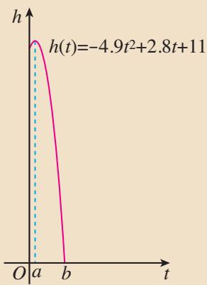
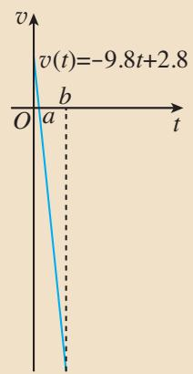
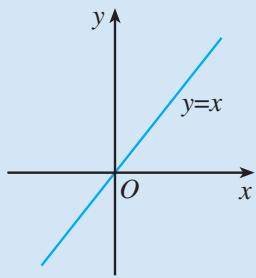
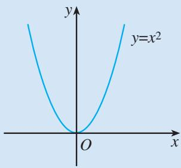
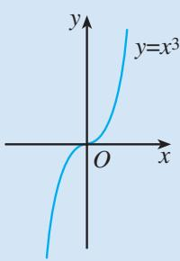
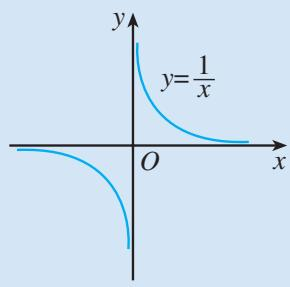
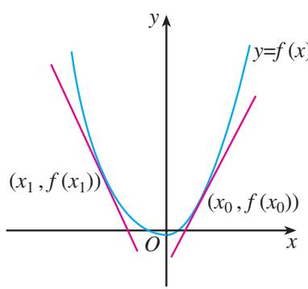

以跳水运动为例，图 5.3-1(1) 是某跳水运动员的重心相对于水面的高度 $h$ 随时间 $t$ 变化的函数 $h(t) = -4.9t^{2} + 2.8t + 11$ 的图象，图 5.3-1(2) 是跳水运动员的速度 $v$ 随时间 $t$ 变化的函数 $v(t) = h'(t) = -9.8t + 2.8$ 的图象，其中 $a = \frac{2}{7}$ ， $b$ 是函数 $h(t)$ 的零点。

  
(1)

  
(2)  
图5.3-1

观察图象可以发现：

（1）从起跳到最高点，运动员的重心处于上升状态，离水面的高度 $h$ 随时间 $t$ 的增加而增加，即 $h(t)$ 单调递增．相应地， $v(t)=h'(t)>0$ 。

（2）从最高点到入水，运动员的重心处于下降状态，离水面的高度 $h$ 随时间 $t$ 的增加而减小，即 $h(t)$ 单调递减．相应地， $v(t)=h'(t)<0$ 。

由此可见，函数 $h(t)$ 的单调性与 $h'(t)$ 的正负有内在联系：

当 $t \in (0, a)$ 时， $h'(t) > 0$ ，函数 $h(t)$ 的图象是“上升”的，函数 $h(t)$ 在 $(0, a)$ 内单调递增；

当 $t \in (a, b)$ 时， $h'(t) < 0$ ，函数 $h(t)$ 的图象是“下降”的，函数 $h(t)$ 在 $(a, b)$ 内单调递减。

进一步考察图 5.3-2 中若干函数的图象，可以看到这种对应关系具有一般性：

  
(1)

  
(2)  
图5.3-2

  
(3)

  
(4)

如图 5.3-3，导数 $f'(x_{0})$ 表示函数 $y=f(x)$ 的图象在点 $(x_{0}, f(x_{0}))$ 处的切线的斜率．可以发现：

在 $x=x_{0}$ 处， $f'(x_{0})>0$ ，切线是“左下右上”的上升式，函数 $f(x)$ 的图象也是上升的，函数 $f(x)$ 在 $x=x_{0}$ 附近单调递增；

在 $x=x_{1}$ 处， $f'(x_{1})<0$ ，切线是“左上右下”的下降式，函数 $f(x)$ 的图象也是下降的，函数 $f(x)$ 在 $x=x_{1}$ 附近单调递减.

  
图5.3-3

一般地，函数 $f(x)$ 的单调性与导函数 $f'(x)$ 的正负之间具有如下的关系：

在某个区间 $(a, b)$ 内，如果 $f'(x) > 0$ ，那么函数 $y = f(x)$ 在区间 $(a, b)$ 内单调递增；

在某个区间 $(a, b)$ 内，如果 $f'(x) < 0$ ，那么函数 $y = f(x)$ 在区间 $(a, b)$ 内单调递减.
