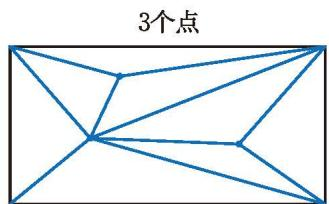
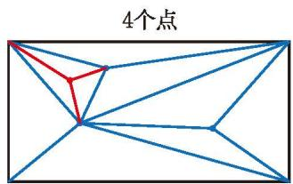
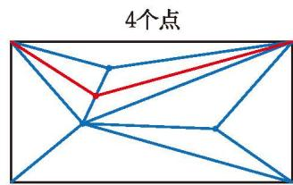

小明的思考过程如下。

(1) 先研究长方形内有 3 个点、4 个点的情形（如图 3-11）。

图3-11

(2) 几种简单情形的数据见下表, 发现规律: 长方形内点的个数增加 1 , 三角形的个数增加 2 。

<table><tr><td>长方形内点的个数</td><td>1</td><td>2</td><td>3</td><td>4</td><td>...</td></tr><tr><td>三角形的个数</td><td>4</td><td>6</td><td>8</td><td>10</td><td>...</td></tr></table>

(3) 猜想是合理的。在长方形内已经有 $n$ 个点的情况下, 新增的一个点要么在某个三角形内部, 要么在某条线段上。当新增的这个点在某个三角形内部时, 连接该点和三角形的顶点, 原来的 1 个三角形分成 3 个小三角形, 三角形的个数增加 2; 当新增的这个点在某条线段上时, 连接该点和它所在两个三角形的顶点, 三角形的个数同样增加 2。

因此，当长方形内有 35 个点时，分得的三角形的个数是

$$
4 + 2 \times 34 = 72 _ {\circ}
$$
