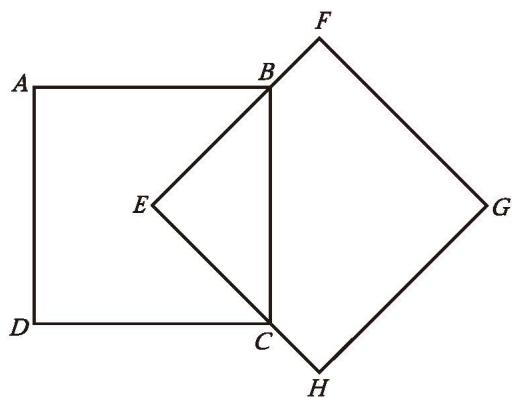
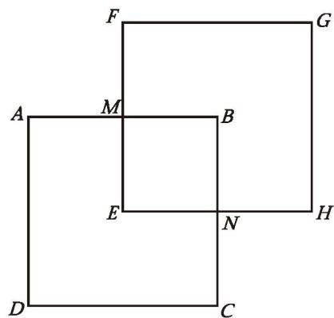

# 小明的特殊化转化解法示范（旋转正方形重叠面积）

## 情境引入与思考

## 知识讲解

### 北师大版初中数学·七年级下册

小明的思考过程如下。

(1) 先考虑特殊情形。如图 4-35、图 4-36, 这两种情形下, 重叠部分的面积容易求出, 都是 $\frac{1}{4}$ 。

图4-35

图4-36

(2) 将一般情形转化为特殊情形。如图 4-37, 连接 $EB$ , $EC$ , 两个正方形重叠部分的面积记作 $S_{\text{重叠}}$ , 则 $S_{\text{重叠}} = S_{\triangle BEC} + S_{\triangle CEN} - S_{\triangle BEM}$ 。可以发现, $\triangle BEM \cong \triangle CEN$ , 这时, 图 4-37 的情形就转化为图 4-35 的情形, $S_{\text{重叠}} = S_{\triangle BEC} = \frac{1}{4}$ 。因此, 一般情形下, 重叠部分的面积也是 $\frac{1}{4}$ 。

图4-37

## 先修知识

- [特殊化策略的思想与适用特点](%E7%89%B9%E6%AE%8A%E5%8C%96%E7%AD%96%E7%95%A5%E7%9A%84%E6%80%9D%E6%83%B3%E4%B8%8E%E9%80%82%E7%94%A8%E7%89%B9%E7%82%B9.md)

## 后续知识

- [特殊化策略方法总结：限制不确定因素考虑最特殊情形](%E7%89%B9%E6%AE%8A%E5%8C%96%E7%AD%96%E7%95%A5%E6%96%B9%E6%B3%95%E6%80%BB%E7%BB%93%EF%BC%9A%E9%99%90%E5%88%B6%E4%B8%8D%E7%A1%AE%E5%AE%9A%E5%9B%A0%E7%B4%A0%E8%80%83%E8%99%91%E6%9C%80%E7%89%B9%E6%AE%8A%E6%83%85%E5%BD%A2.md)

## 本节例题与练习

- [特殊化策略练习 1](../%E4%B9%A0%E9%A2%98/Q070000000265.md)
- [特殊化策略练习 2](../%E4%B9%A0%E9%A2%98/Q070000000266.md)
- [特殊化策略练习 3](../%E4%B9%A0%E9%A2%98/Q070000000267.md)
- [特殊化策略练习 4](../%E4%B9%A0%E9%A2%98/Q070000000268.md)

## 所属组织

- [问题解决策略：特殊化](../%E7%9F%A5%E8%AF%86%E4%B8%B2%E8%81%94/%E5%8C%97%E5%B8%88%E5%A4%A7-%E4%B8%83%E5%B9%B4%E7%BA%A7%E4%B8%8B%E5%86%8C/%E7%AC%AC%E5%9B%9B%E7%AB%A0%20%E4%B8%89%E8%A7%92%E5%BD%A2/%E9%97%AE%E9%A2%98%E8%A7%A3%E5%86%B3%E7%AD%96%E7%95%A5-%E7%89%B9%E6%AE%8A%E5%8C%96.md)

## 相关练习组织（范围关联）

- [问题解决策略：特殊化](../%E9%A2%98%E5%9E%8B/%E6%8C%89%E7%AB%A0%E8%8A%82%E5%88%86%E7%B1%BB/%E5%8C%97%E5%B8%88%E5%A4%A7-%E4%B8%83%E5%B9%B4%E7%BA%A7%E4%B8%8B%E5%86%8C/%E7%AC%AC%E5%9B%9B%E7%AB%A0%20%E4%B8%89%E8%A7%92%E5%BD%A2/%E9%97%AE%E9%A2%98%E8%A7%A3%E5%86%B3%E7%AD%96%E7%95%A5-%E7%89%B9%E6%AE%8A%E5%8C%96.md)
