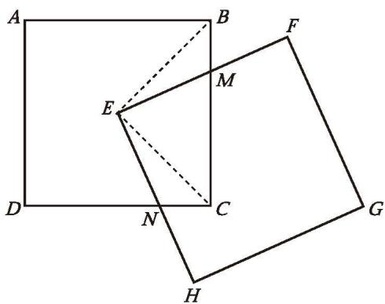

# 小明的特殊化转化解法示范（旋转正方形重叠面积）

## 北师大版初中数学·七年级下册

小明的思考过程如下。

(1) 先考虑特殊情形。如图 4-35、图 4-36, 这两种情形下, 重叠部分的面积容易求出, 都是 $\frac{1}{4}$ 。

图4-35

图4-36

(2) 将一般情形转化为特殊情形。如图 4-37, 连接 $EB$ , $EC$ , 两个正方形重叠部分的面积记作 $S_{\text{重叠}}$ , 则 $S_{\text{重叠}} = S_{\triangle BEC} + S_{\triangle CEN} - S_{\triangle BEM}$ 。可以发现, $\triangle BEM \cong \triangle CEN$ , 这时, 图 4-37 的情形就转化为图 4-35 的情形, $S_{\text{重叠}} = S_{\triangle BEC} = \frac{1}{4}$ 。因此, 一般情形下, 重叠部分的面积也是 $\frac{1}{4}$ 。

图4-37
