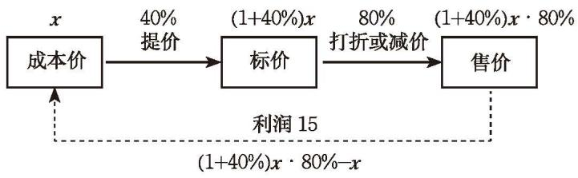

# 小明的直观分析解答示范：销售过程框图与方程求解

## 情境引入与思考

## 知识讲解

### 北师大版初中数学·七年级上册

小明用图 5-6 所示的框图直观地表示了商店从进货、标价到销售获利的过程，并将问题中的数量信息标注在框图中。据此，他列出了方程

$$
(1 + 40\%) x \cdot 80\% - x = 15_{\circ}
$$

解这个方程，得 $x = 125$ 。

因此，这种服装每件的成本是 125 元。

图5-6

## 本节例题与练习

- [直观分析策略练习 1](../%E4%B9%A0%E9%A2%98/Q070000002257.md)
- [直观分析策略练习 2](../%E4%B9%A0%E9%A2%98/Q070000002258.md)
- [直观分析策略练习 3](../%E4%B9%A0%E9%A2%98/Q070000002259.md)
- [直观分析策略练习 4](../%E4%B9%A0%E9%A2%98/Q070000002260.md)
- [直观分析策略练习 5](../%E4%B9%A0%E9%A2%98/Q070000002261.md)

## 所属组织

- [问题解决策略：直观分析](../%E7%9F%A5%E8%AF%86%E4%B8%B2%E8%81%94/%E5%8C%97%E5%B8%88%E5%A4%A7-%E4%B8%83%E5%B9%B4%E7%BA%A7%E4%B8%8A%E5%86%8C/%E7%AC%AC%E4%BA%94%E7%AB%A0%20%E4%B8%80%E5%85%83%E4%B8%80%E6%AC%A1%E6%96%B9%E7%A8%8B/%E9%97%AE%E9%A2%98%E8%A7%A3%E5%86%B3%E7%AD%96%E7%95%A5-%E7%9B%B4%E8%A7%82%E5%88%86%E6%9E%90.md)

## 相关练习组织（范围关联）

- [问题解决策略：直观分析](../%E9%A2%98%E5%9E%8B/%E6%8C%89%E7%AB%A0%E8%8A%82%E5%88%86%E7%B1%BB/%E5%8C%97%E5%B8%88%E5%A4%A7-%E4%B8%83%E5%B9%B4%E7%BA%A7%E4%B8%8A%E5%86%8C/%E7%AC%AC%E4%BA%94%E7%AB%A0%20%E4%B8%80%E5%85%83%E4%B8%80%E6%AC%A1%E6%96%B9%E7%A8%8B/%E9%97%AE%E9%A2%98%E8%A7%A3%E5%86%B3%E7%AD%96%E7%95%A5-%E7%9B%B4%E8%A7%82%E5%88%86%E6%9E%90.md)
