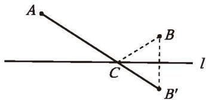

# 小明的轴对称最短路径转化模型示范（将军饮马模型）

## 北师大版初中数学·七年级下册

小明的思考过程如下。

如图 5-25, 作点 $B$ 关于 $l$ 的对称点 $B'$ , 根据轴对称的性质, 对于 $l$ 上任意一点 $C$ , 都有 $BC = B'C$ , 因此 $AC + BC = AC + B'C$ , 问题转化为: 在直线 $l$ 上确定一个点 $C$ , 使 $AC + B'C$ 最短。

根据 “两点之间线段最短”，连接 $AB'$ ，与 l 交于点 C，点 C 就是所要确定的点。

图5-25
