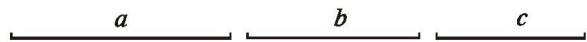
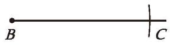
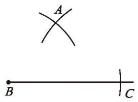
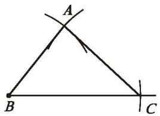

通过刚才的探究过程，我们可以总结出“已知三角形的三边，用尺规作这个三角形”的方法和步骤。

如图 4-21, 已知线段 $a, b, c$ , 用尺规作 $\triangle ABC$ , 使 $AB = c$ , $AC = b$ , $BC = a$ 。

图4-21

作法与示范：

<table><tr><td>作法</td><td>示范</td></tr><tr><td>1. 作一条线段  $BC = a$ 。</td><td></td></tr><tr><td>2. 分别以点  $B, C$  为圆心,以  $c, b$  的长为半径作弧,两弧交于点  $A$ 。</td><td></td></tr><tr><td>3. 连接  $AB, AC$ 。 $\triangle ABC$  就是所要作的三角形。</td><td></td></tr></table>
