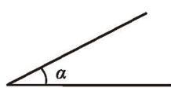
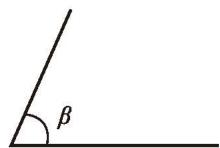

回顾上述作图过程，请你总结“已知三角形的两角及其夹边，用尺规作这个三角形”的方法和步骤。

如图 4-26，已知 $\angle \alpha, \angle \beta$ ，线段 c，用尺规作 $\triangle ABC$ ，使 $\angle A = \angle \alpha, \angle B = \angle \beta, AB = c$ 。

图4-26

请按照给出的作法作出相应的图形:

<table><tr><td>作法</td><td>图形</td></tr><tr><td>1. 作 $\angle {DAF} = \angle \alpha$ 。2. 在射线  ${AF}$  上截取线段  ${AB} = {c}_{\circ }$ 。3. 以点  $B$  为顶点,以  ${BA}$  为一边,作 $\angle {ABE} = \angle \beta ,{BE}$  交  ${AD}$  于点  $C$  。 $\bigtriangleup {ABC}$  就是所要作的三角形。</td><td></td></tr></table>
