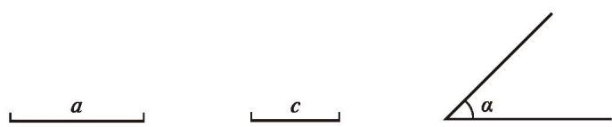

回顾上述作图过程，请你总结“已知三角形的两边及其夹角，用尺规作这个三角形”的方法和步骤。

如图 4-27, 已知线段 $a, c, \angle \alpha$ , 用尺规作 $\triangle ABC$ , 使 $BC = a$ , $AB = c$ , $\angle ABC = \angle \alpha$ 。

图4-27

请按照给出的作法作出相应的图形：

<table><tr><td>作法</td><td>图形</td></tr><tr><td>1. 作一条线段  $BC = a$ 。2. 以点  $B$  为顶点,以  $BC$  为一边,作角 $\angle DBC = \angle \alpha$ 。3. 在射线  $BD$  上截取线段  $BA = c$ 。4. 连接  $AC$ 。 $\triangle ABC$  就是所要作的三角形。</td><td></td></tr></table>
