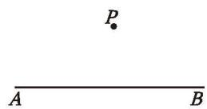
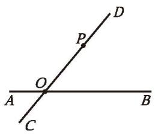
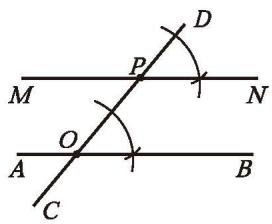

如图 2-27, 已知点 $P$ 在直线 $AB$ 外, 用尺规作直线 $MN$ , 使 $MN$ 经过点 $P$ , 且 $MN \parallel AB$ 。

图2-27

作法与示范:

(第1题)

<table><tr><td>作法</td><td>示范</td></tr><tr><td>1. 在直线AB上任取一点O,过点O,P作直线CD。</td><td></td></tr><tr><td>2. 以点P为顶点,以PD为一边,在直线CD的右侧作∠DPN=∠DOB。PN边所在的直线MN就是要作的直线。</td><td></td></tr></table>

你能说说这样作的道理吗？
