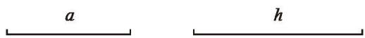

如图 1-31，已知线段 a, h，用尺规作 $\triangle ABC$ ，使 AB = AC，BC = a，高 AD = h。

图1-31

请按照给出的作法作出相应的图形：

<table><tr><td>作法</td><td>图形</td></tr><tr><td>1. 作线段  $BC$ ,使  $BC = a$ 。2. 作线段  $BC$  的垂直平分线  $l$ ,交  $BC$  于点  $D$ 。3. 在  $l$  上截取  $DA = h$ 。4. 连接  $AB$ , $AC$ 。 $\triangle ABC$  就是所要作的等腰三角形。</td><td></td></tr></table>
