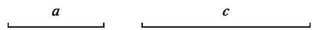

如图 1-26, 已知线段 $a$ , $c$ ( $a < c$ ), 用尺规作 Rt $\triangle ABC$ , 使 $\angle C = 90^\circ$ , $AB = c$ , $BC = a$ 。

图1-26

请按照给出的作法作出相应的图形：

<table><tr><td>作法</td><td>图形</td></tr><tr><td>1. 作射线 CN。2. 过点 C 作射线 CN 的垂线 CM。3. 在射线 CM 上截取 CB = a。4. 以点 B 为圆心,以线段 c 的长为半径作弧,交射线 CN 于点 A。5. 连接 AB。△ABC 就是所要作的直角三角形。</td><td></td></tr></table>

把你作的三角形与同伴作的三角形进行比较，它们一定全等吗？
