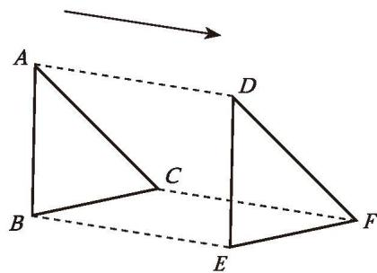

# 平移的概念及对应元素

## 北师大版初中数学·八年级下册

在平面内，将一个图形沿某个方向移动一定的距离，这样的图形运动称为平移（translation）。平移不改变图形的形状和大小。

如图 3-2, $\triangle ABC$ 经过平移得到 $\triangle DEF$ , 点 $A, B, C$ 分别平移到了点 $D, E, F$ 。点 $A$ 与点 $D$ 是一组对应点, 线段 $AB$ 与线段 $DE$ 是一组对应线段, $\angle BAC$ 与 $\angle EDF$ 是一组对应角。

你还能从图 3-2 中找出其他的对应点、对应线段和对应角吗？

图3-2
