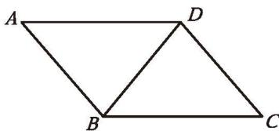

# 平行四边形与对角线的概念及符号表示

## 情境引入与思考

## 知识讲解

### 北师大版初中数学·八年级下册

两组对边分别平行的四边形叫作平行四边形（parallelogram）。平行四边形不相邻的两个顶点连成的线段叫作它的对角线。如图6-2，四边形ABCD是平行四边形，记作□ABCD，读作“平行四边形ABCD”，线段BD就是□ABCD的一条对角线。

图6-2

## 本节例题与练习

- [6.1 随堂练习第1题](../%E4%B9%A0%E9%A2%98/Q070000003170.md)
- [6.1 随堂练习第2题](../%E4%B9%A0%E9%A2%98/Q070000003171.md)
- [例1 利用平行四边形对边相等证明线段相等](../%E4%B9%A0%E9%A2%98/Q070000003169.md)

## 所属组织

- [平行四边形的定义与边角性质](../%E7%9F%A5%E8%AF%86%E4%B8%B2%E8%81%94/%E5%8C%97%E5%B8%88%E5%A4%A7-%E5%85%AB%E5%B9%B4%E7%BA%A7%E4%B8%8B%E5%86%8C/%E7%AC%AC%E5%85%AD%E7%AB%A0%20%E5%B9%B3%E8%A1%8C%E5%9B%9B%E8%BE%B9%E5%BD%A2/1%20%E5%B9%B3%E8%A1%8C%E5%9B%9B%E8%BE%B9%E5%BD%A2%E7%9A%84%E6%80%A7%E8%B4%A8/%E5%B9%B3%E8%A1%8C%E5%9B%9B%E8%BE%B9%E5%BD%A2%E7%9A%84%E5%AE%9A%E4%B9%89%E4%B8%8E%E8%BE%B9%E8%A7%92%E6%80%A7%E8%B4%A8.md)

## 相关练习组织（范围关联）

- [平行四边形的定义与边角性质](../%E9%A2%98%E5%9E%8B/%E6%8C%89%E7%AB%A0%E8%8A%82%E5%88%86%E7%B1%BB/%E5%8C%97%E5%B8%88%E5%A4%A7-%E5%85%AB%E5%B9%B4%E7%BA%A7%E4%B8%8B%E5%86%8C/%E7%AC%AC%E5%85%AD%E7%AB%A0%20%E5%B9%B3%E8%A1%8C%E5%9B%9B%E8%BE%B9%E5%BD%A2/%E5%B9%B3%E8%A1%8C%E5%9B%9B%E8%BE%B9%E5%BD%A2%E7%9A%84%E6%80%A7%E8%B4%A8.md)
