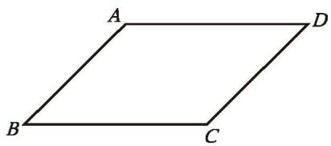

# 平行四边形判定定理：一组对边平行且相等

## 北师大版初中数学·八年级下册

我们还发现：一组对边平行且相等的四边形是平行四边形。请你尝试证明这一结论。

已知：如图 6-10（1），在四边形 ABCD 中， $AB \parallel CD$ 。

求证: 四边形 $ABCD$ 是平行四边形。

(1)

图6-10

(2)

证明：如图6-10（2），连接 $AC$ 。\$\because AB \parallel CD,\$
\$\therefore \angle BAC = \angle DCA\$。
又\$\because AB = CD, AC = CA,\$
\$\therefore \triangle ABC \cong \triangle CDA\$。
\$\therefore BC = DA\$。

你还有其他证法吗？与同伴进行交流。

∴ 四边形 ABCD 是平行四边形（两组对边分别相等的四边形是平行四边形）。

定理 一组对边平行且相等的四边形是平行四边形。
