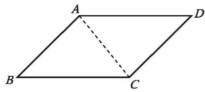

# 平行四边形判定定理：一组对边平行且相等

## 情境引入与思考

## 知识讲解

### 北师大版初中数学·八年级下册

我们还发现：一组对边平行且相等的四边形是平行四边形。请你尝试证明这一结论。

已知：如图 6-10（1），在四边形 ABCD 中， $AB \parallel CD$ 。

求证: 四边形 $ABCD$ 是平行四边形。

(1)

图6-10

(2)

证明：如图6-10（2），连接 $AC$ 。\$\because AB \parallel CD,\$
\$\therefore \angle BAC = \angle DCA\$。
又\$\because AB = CD, AC = CA,\$
\$\therefore \triangle ABC \cong \triangle CDA\$。
\$\therefore BC = DA\$。

你还有其他证法吗？与同伴进行交流。

∴ 四边形 ABCD 是平行四边形（两组对边分别相等的四边形是平行四边形）。

定理 一组对边平行且相等的四边形是平行四边形。

## 本节例题与练习

- [6.2 随堂练习第1题](../%E4%B9%A0%E9%A2%98/Q070000003184.md)
- [6.2 随堂练习第2题](../%E4%B9%A0%E9%A2%98/Q070000003185.md)
- [例1 利用“一组对边平行且相等”证明四边形是平行四边形](../%E4%B9%A0%E9%A2%98/Q070000003183.md)

## 所属组织

- [平行四边形的边判定定理](../%E7%9F%A5%E8%AF%86%E4%B8%B2%E8%81%94/%E5%8C%97%E5%B8%88%E5%A4%A7-%E5%85%AB%E5%B9%B4%E7%BA%A7%E4%B8%8B%E5%86%8C/%E7%AC%AC%E5%85%AD%E7%AB%A0%20%E5%B9%B3%E8%A1%8C%E5%9B%9B%E8%BE%B9%E5%BD%A2/2%20%E5%B9%B3%E8%A1%8C%E5%9B%9B%E8%BE%B9%E5%BD%A2%E7%9A%84%E5%88%A4%E5%AE%9A/%E5%B9%B3%E8%A1%8C%E5%9B%9B%E8%BE%B9%E5%BD%A2%E7%9A%84%E8%BE%B9%E5%88%A4%E5%AE%9A%E5%AE%9A%E7%90%86.md)

## 相关练习组织（范围关联）

- [平行四边形的边判定定理](../%E9%A2%98%E5%9E%8B/%E6%8C%89%E7%AB%A0%E8%8A%82%E5%88%86%E7%B1%BB/%E5%8C%97%E5%B8%88%E5%A4%A7-%E5%85%AB%E5%B9%B4%E7%BA%A7%E4%B8%8B%E5%86%8C/%E7%AC%AC%E5%85%AD%E7%AB%A0%20%E5%B9%B3%E8%A1%8C%E5%9B%9B%E8%BE%B9%E5%BD%A2/%E5%B9%B3%E8%A1%8C%E5%9B%9B%E8%BE%B9%E5%BD%A2%E7%9A%84%E5%88%A4%E5%AE%9A.md)
