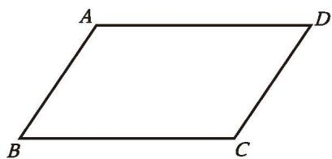
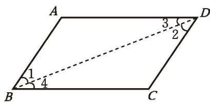

我们发现：两组对边分别相等的四边形是平行四边形。请你尝试证明这一结论。

已知：如图 6-9 (1)，在四边形 ABCD 中，AB = CD，AD = CB。

求证: 四边形 $ABCD$ 是平行四边形。

(1)

图6-9

(2)

证明：如图 6-9（2），连接 BD。

在 $\triangle ABD$ 和 $\triangle CDB$ 中，

$$
\because A B = C D, A D = C B, B D = D B,
$$

$$
\therefore \quad \triangle A B D \cong \triangle C D B _ {\circ}
$$

$$
\therefore \angle 1 = \angle 2, \angle 3 = \angle 4 。
$$

$$
\therefore A B \parallel C D, A D \parallel C B 。
$$

∴ 四边形 ABCD 是平行四边形（平行四边形的定义）。

定理 两组对边分别相等的四边形是平行四边形。
