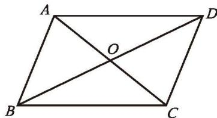

# 平行四边形判定定理：对角线互相平分

## 情境引入与思考

## 知识讲解

### 北师大版初中数学·八年级下册

通过上一课 “思考·交流” 的讨论, 我们还发现: 对角线互相平分的四边形是平行四边形。请你尝试证明这一结论。

已知：如图 6-12，四边形 ABCD 的两条对角线 AC 与 BD 相交于点 O，并且 OA = OC，OB = OD。

求证: 四边形 $ABCD$ 是平行四边形。

图6-12

证明：∵ OA = OC, OD = OB, $\angle AOD = \angle COB,$ ∴ $\triangle AOD \cong \triangle COB_{\circ}$ ∴ AD = CB, $\angle ADO = \angle CBO_{\circ}$ ∴ $AD \parallel CB_{\circ}$

∴ 四边形 ABCD 是平行四边形（一组对边平行且相等的四边形是平行四边形）。

定理 对角线互相平分的四边形是平行四边形。

## 本节例题与练习

- [6.2 随堂练习第3题](../%E4%B9%A0%E9%A2%98/Q070000003187.md)
- [例2 利用“对角线互相平分”证明四边形是平行四边形](../%E4%B9%A0%E9%A2%98/Q070000003186.md)

## 所属组织

- [平行四边形的对角线判定定理](../%E7%9F%A5%E8%AF%86%E4%B8%B2%E8%81%94/%E5%8C%97%E5%B8%88%E5%A4%A7-%E5%85%AB%E5%B9%B4%E7%BA%A7%E4%B8%8B%E5%86%8C/%E7%AC%AC%E5%85%AD%E7%AB%A0%20%E5%B9%B3%E8%A1%8C%E5%9B%9B%E8%BE%B9%E5%BD%A2/2%20%E5%B9%B3%E8%A1%8C%E5%9B%9B%E8%BE%B9%E5%BD%A2%E7%9A%84%E5%88%A4%E5%AE%9A/%E5%B9%B3%E8%A1%8C%E5%9B%9B%E8%BE%B9%E5%BD%A2%E7%9A%84%E5%AF%B9%E8%A7%92%E7%BA%BF%E5%88%A4%E5%AE%9A%E5%AE%9A%E7%90%86.md)

## 相关练习组织（范围关联）

- [平行四边形的对角线判定定理](../%E9%A2%98%E5%9E%8B/%E6%8C%89%E7%AB%A0%E8%8A%82%E5%88%86%E7%B1%BB/%E5%8C%97%E5%B8%88%E5%A4%A7-%E5%85%AB%E5%B9%B4%E7%BA%A7%E4%B8%8B%E5%86%8C/%E7%AC%AC%E5%85%AD%E7%AB%A0%20%E5%B9%B3%E8%A1%8C%E5%9B%9B%E8%BE%B9%E5%BD%A2/%E5%B9%B3%E8%A1%8C%E5%9B%9B%E8%BE%B9%E5%BD%A2%E7%9A%84%E5%88%A4%E5%AE%9A.md)
