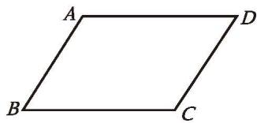
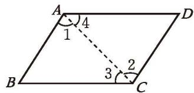

平行四边形是中心对称图形，两条对角线的交点是它的对称中心。

我们还发现：平行四边形的对边相等、对角相等。

已知：如图 6-3（1），四边形 ABCD 是平行四边形。

求证: $AB = CD, BC = DA$ 。

分析：要证明两条线段相等，你常用什么方法？在平行四边形中能直接使用这种方法吗？你能构造出可以使用这种方法的图形吗？

(1)

图6-3

(2)

证明：如图 6-3（2），连接 AC。

∵ 四边形 ABCD 是平行四边形，

∴ AB∥CD，BC∥DA（平行四边形的定义）。

$$
\therefore \angle 1 = \angle 2, \angle 3 = \angle 4 。
$$

$$
\because A C = C A,
$$

$$
\therefore \quad \triangle A B C \cong \triangle C D A _ {\circ}
$$

$$
\therefore A B = C D, B C = D A _ {\circ}
$$

请你证明：平行四边形的对角相等。

定理 平行四边形的对边相等。

定理 平行四边形的对角相等。
