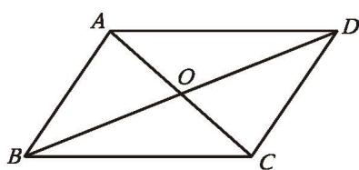

# 平行四边形的对角线互相平分定理及证明

## 情境引入与思考

## 知识讲解

### 北师大版初中数学·八年级下册

在上一课的“思考·交流”中，我们还发现：平行四边形的对角线互相平分。请你尝试证明这一结论。

已知：如图 6-5, □ABCD 的两条对角线 AC 与 BD 相交于点 O。

求证：OA = OC，OB = OD。

证明：∵ 四边形 ABCD 是平行四边形，

图6-5

∴ AB = CD (平行四边形的对边相等),

$AB \parallel CD$ （平行四边形的定义）。

$$
\therefore \angle B A O = \angle D C O, \angle A B O = \angle C D O _ {\circ}
$$

$$
\therefore \quad \triangle A B O \cong \triangle C D O _ {\circ}
$$

还有其他证法吗？

$$
\therefore O A = O C, O B = O D _ {\circ}
$$

定理 平行四边形的对角线互相平分。

## 本节例题与练习

- [6.1 随堂练习第3题](../%E4%B9%A0%E9%A2%98/Q070000003173.md)
- [6.1 随堂练习第4题](../%E4%B9%A0%E9%A2%98/Q070000003174.md)
- [例2 利用平行四边形对角线互相平分证明线段相等](../%E4%B9%A0%E9%A2%98/Q070000003172.md)

## 所属组织

- [平行四边形的对角线性质](../%E7%9F%A5%E8%AF%86%E4%B8%B2%E8%81%94/%E5%8C%97%E5%B8%88%E5%A4%A7-%E5%85%AB%E5%B9%B4%E7%BA%A7%E4%B8%8B%E5%86%8C/%E7%AC%AC%E5%85%AD%E7%AB%A0%20%E5%B9%B3%E8%A1%8C%E5%9B%9B%E8%BE%B9%E5%BD%A2/1%20%E5%B9%B3%E8%A1%8C%E5%9B%9B%E8%BE%B9%E5%BD%A2%E7%9A%84%E6%80%A7%E8%B4%A8/%E5%B9%B3%E8%A1%8C%E5%9B%9B%E8%BE%B9%E5%BD%A2%E7%9A%84%E5%AF%B9%E8%A7%92%E7%BA%BF%E6%80%A7%E8%B4%A8.md)

## 相关练习组织（范围关联）

- [平行四边形的对角线性质](../%E9%A2%98%E5%9E%8B/%E6%8C%89%E7%AB%A0%E8%8A%82%E5%88%86%E7%B1%BB/%E5%8C%97%E5%B8%88%E5%A4%A7-%E5%85%AB%E5%B9%B4%E7%BA%A7%E4%B8%8B%E5%86%8C/%E7%AC%AC%E5%85%AD%E7%AB%A0%20%E5%B9%B3%E8%A1%8C%E5%9B%9B%E8%BE%B9%E5%BD%A2/%E5%B9%B3%E8%A1%8C%E5%9B%9B%E8%BE%B9%E5%BD%A2%E7%9A%84%E6%80%A7%E8%B4%A8.md)
